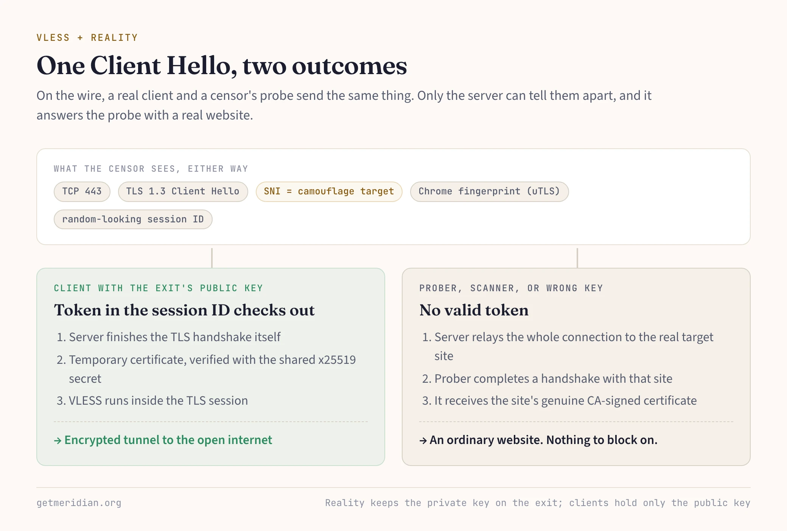
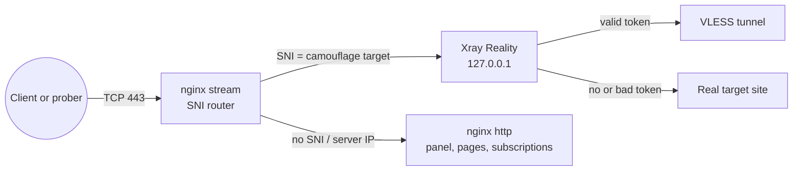

Meridian puts VLESS+Reality first on every exit. This post explains why: what censors actually look for, how Reality answers each check, and where it stops helping.

### What censors detect

Published measurements describe three methods.

**Protocol fingerprinting.** A protocol with fixed bytes or packet sizes can be matched on the wire. WireGuard's handshake initiation is always 148 bytes and starts with a fixed message type; its authors state it does not aim for obfuscation. The USENIX Security 2022 paper *OpenVPN is Open to VPN Fingerprinting* identified over 85% of OpenVPN flows at a million-user ISP with negligible false positives, and also flagged 34 of 41 "obfuscated" VPN configurations.

**Looking like nothing is also a fingerprint.** Protocols that encrypt every byte, such as Shadowsocks and VMess, try to look random. Since November 2021 China's Great Firewall has blocked traffic *because* it looks random: it exempts traffic that resembles known protocols and blocks a share of what remains (USENIX Security 2023, *How the Great Firewall of China Detects and Blocks Fully Encrypted Traffic*).

**Active probing.** A suspicious server gets test connections from the censor. The IMC 2020 study *How China Detects and Blocks Shadowsocks* found the GFW picks suspects by the length and entropy of the first packet, then sends seven kinds of probes and blocks the server if it answers like a proxy.

A protocol that survives all three must look like a common protocol, use a common client implementation of it, and give a stranger a believable answer.

### How Reality works

Reality, part of Xray-core, uses TLS 1.3, the most common protocol on port 443, and needs no certificate of its own. The server is configured with a **camouflage target**: a real HTTPS site it impersonates.

1. Each exit has an x25519 keypair. Clients get the public key; the private key stays on the server.
2. The client sends a TLS Client Hello whose SNI names the target. It derives a shared secret from its ephemeral TLS key share and the server's public key, and hides an encrypted token, including a short ID, in the session ID field.
3. If the token checks out, the server finishes the handshake itself, presenting a temporary certificate the client verifies with the shared secret rather than a CA chain. VLESS then carries traffic inside the TLS session.
4. If the token is missing or wrong, or the SNI is not on the server's list, the server relays the whole connection to the real target. The prober completes a handshake with that site and gets its genuine, CA-signed certificate.

Step 4 is the answer to active probing. A probe has no "wrong" response to trigger: it talks to a real website. Step 2 hides the authentication inside a field every TLS 1.3 Client Hello already contains.



The client side matters too. A Go program's default TLS stack has its own Client Hello fingerprint, so Xray clients use **uTLS** to copy a browser's Client Hello byte for byte. Meridian defaults to Chrome and adds Firefox copies as backup entries in each subscription. `meridian deploy --fingerprint` switches to `safari`, `ios`, `android`, `edge`, or `random` if a region starts flagging the current one.

### The target has to fit the server

A censor sees the SNI next to the server's IP. If the SNI names a large foreign site but the IP belongs to a small VPS provider, the pair is odd even though every byte checks out. The best target is a site hosted in the same network as the server, so its DNS really points there.

On a first deploy without `--sni`, Meridian scans the server's own subnet for about a minute. It keeps sites whose DNS points into that subnet and that pass Reality's TLS 1.3 and HTTP/2 check. If none qualify, it falls back to `www.google.com`, `dl.google.com`, and `www.cloudflare.com`. It keeps the first target that real traffic passes through. A target you pass yourself is never swapped:

```bash
meridian deploy 198.51.100.10 --sni dl.google.com
```

`meridian scan` lists candidates on the server's network. Avoid `apple.com` and `icloud.com`: their networks don't match VPS providers. `www.microsoft.com` fails a different way: its certificate chain exceeds Reality's 8192-byte limit, so the deploy converges but no traffic passes.

### How Meridian wires it

Reality does not listen on the public port itself. nginx owns TCP/443 and routes each connection by SNI without terminating TLS:



Connections without an SNI reach nginx's own TLS server, which serves the panel, connection pages, and subscriptions with a Let's Encrypt certificate for the server's IP. The Reality port is closed to the internet by UFW.

Two details keep clients working. Meridian renders Reality's `minClientVer` as `1.8.0`: newer Xray versions default to a minimum that silently rejects Mihomo and sing-box clients, which announce 1.8.x. Key material is also treated as atomic. A redeploy keeps the existing keypair and short ID, refuses partial key state instead of rotating it, and `meridian node replace` carries the keys to the new server, so existing links keep working.

### Where Reality stops helping

Reality hides what a connection is. It does not hide where it goes.

- **IP blocking.** A censor can block the server's address regardless of protocol. Meridian's answers are relays (Realm TCP forwarders on a domestic IP that carry Reality end to end to the exit) and domain mode, where XHTTP and WSS travel through Cloudflare's CDN.
- **UDP-friendly networks.** On lossy links, Hysteria2 on UDP/443, wrapped in salamander obfuscation so it doesn't look like QUIC, is on by default as a last resort.
- **SNI blocking or allowlists.** If the target's name is blocked, the disguise works against you. Run `meridian test --probe` from inside the censored network: it reports whether the server IP or the camouflage SNI looks blocked.

Every subscription lists all of these paths. Apps that import the Xray JSON, Mihomo, or sing-box format, such as Happ, switch to a working path by themselves; other apps show each path as a separate entry.

Further reading: [Architecture: how Reality works](/en/architecture/#how-reality-works) and [choosing a camouflage target](/en/deploy/#choosing-a-camouflage-target).
