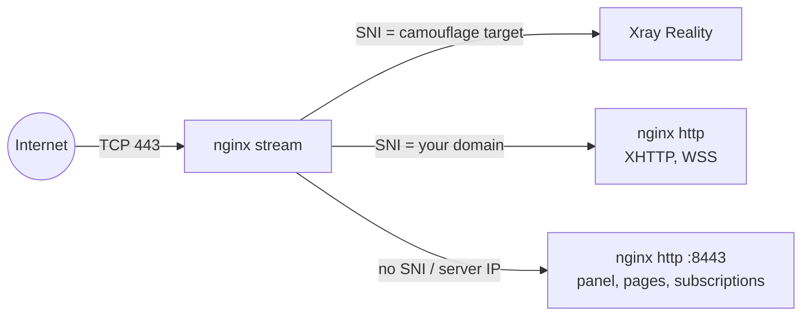

Most proxy guides stop when the client connects. A working server can still give itself away: SSH that accepts passwords, a panel on its own port, a container port that skips the firewall, a self-signed certificate on 443. This post walks through what `meridian deploy` changes on a fresh server and why.

## SSH: one drop-in that actually wins

Meridian writes `/etc/ssh/sshd_config.d/00-hardening.conf`:

```
PasswordAuthentication no
KbdInteractiveAuthentication no
ChallengeResponseAuthentication no
DebianBanner no
```

The file name matters. sshd uses the first value it reads for each keyword, and drop-ins are read in name order. Cloud images often ship their own drop-in that turns passwords back on, so Meridian also comments out those keywords in every other drop-in. Then it runs `sshd -t` to validate the config, and reads `sshd -T` to confirm the *effective* values before restarting sshd. A file that says "no" while another file says "yes" does not count as hardened.

`DebianBanner no` removes the distribution suffix from the SSH version string. fail2ban runs an sshd jail on the systemd journal backend, because Debian 12 has no `auth.log` and a jail that reads a missing log file makes fail2ban exit right after it starts. Unattended security upgrades are enabled too.

## Firewall: deny by default, open per role

UFW denies all inbound traffic. Meridian opens only what the server's role needs:

| Rule | When |
|------|------|
| SSH port(s) | Always: the ports `sshd -T` reports plus the port of the current session |
| TCP/443 | Exits and the control server |
| TCP/80 | Only where a certificate is issued (ACME challenges) |
| UDP/443 | Only when Hysteria2 is on (the default) |
| Relay listen port | Relay servers |

Meridian never assumes SSH is on 22. Before it enables UFW, it allows every port sshd actually listens on, plus the port the current session came in on, so a custom port or a socket-activated sshd can't lock you out. Each public rule comes from the reviewed plan and carries a comment, so removing a role later deletes exactly the rules that role added.

## Docker ports skip UFW

Docker writes its own iptables rules for published ports, and those rules match before UFW's. A container published as `3000:3000` is open to the internet whatever `ufw status` says.

Meridian avoids the problem by never publishing a public container port. The Remnawave backend binds `127.0.0.1:3000` and the subscription page `127.0.0.1:3020`. PostgreSQL and Valkey publish nothing; they sit on a private bridge network. The Remnawave node runs Xray in host networking, so its listeners go through the normal input chain, where UFW blocks them.


## One public port, routed by SNI

nginx owns TCP/443. Its stream module reads the SNI from the TLS Client Hello and forwards the raw TCP stream without decrypting it:



Xray's backend ports (10000 and up) are never exposed; only nginx reaches them. The panel lives at a secret HTTPS path on the same port, so there is no admin port to find and no SSH tunnel to set up. Connection pages and subscription links use a separate path and never reveal the panel's.

Everything else gets a plain answer: `403` at the root, `404` for unknown paths, `server_tokens off`, and only TLS 1.2 and 1.3. Meridian never uses nginx's `return 444`, which closes the connection without a response. That silent close is an unusual signature of its own.

## Two kinds of TLS

Reality does not use a certificate of yours. A prober that connects without the client key is passed through to the real camouflage site and receives that site's genuine certificate. So the camouflage target is the setting that matters most. Without `--sni`, a first deploy scans the server's own subnet for TLS 1.3 sites with HTTP/2 whose DNS points into that network. If none passes, it falls back to `www.google.com`, `dl.google.com`, and `www.cloudflare.com`, and keeps the first target that real traffic passes through. Avoid `apple.com` and `icloud.com`: their networks don't match hosting providers. Avoid `www.microsoft.com` as well. Its certificate chain is too large for REALITY, so the deploy completes but no traffic passes.

Everything nginx terminates itself (the panel, connection pages, subscriptions, and XHTTP without a domain) uses a real Let's Encrypt certificate from acme.sh. With no domain, that is a short-lived certificate for the server's IP, renewed automatically. Domain mode adds a certificate for your domain. nginx starts on a temporary self-signed certificate only so the ACME challenge can run. If Let's Encrypt can't issue a trusted one, the deploy fails instead of leaving the self-signed certificate in place, and panel credentials never travel over it.

## BBR

Meridian sets `net.core.default_qdisc=fq` and `net.ipv4.tcp_congestion_control=bbr` and persists both in `/etc/sysctl.conf`. Linux's default, CUBIC, treats packet loss as congestion and backs off. BBR models the path's bottleneck bandwidth and round-trip time instead, so random loss on a long international route doesn't cut throughput nearly as hard. It's a throughput setting, not a security one, but it belongs to the same server baseline.

## When not to harden, and how to check

`--no-harden` skips the SSH changes, fail2ban, and the firewall. It exists for servers shared with other services. Fleet servers added with `meridian node add` always get hardened.

To see the server the way a censor's prober does, run this from outside:

```
meridian test --probe 198.51.100.10
```

It checks public and internal port exposure, TLS and HTTP behavior, common panel and proxy paths, legacy TLS versions, and SNI consistency. `meridian plan` re-observes the firewall rules, nginx files, and containers Meridian owns, so a manual edit shows up as repair work. The next `meridian apply` restores it.

Full list of security defaults: [Security](/en/security/). How to pick a target: [Choosing a camouflage target](/en/deploy/#choosing-a-camouflage-target).
