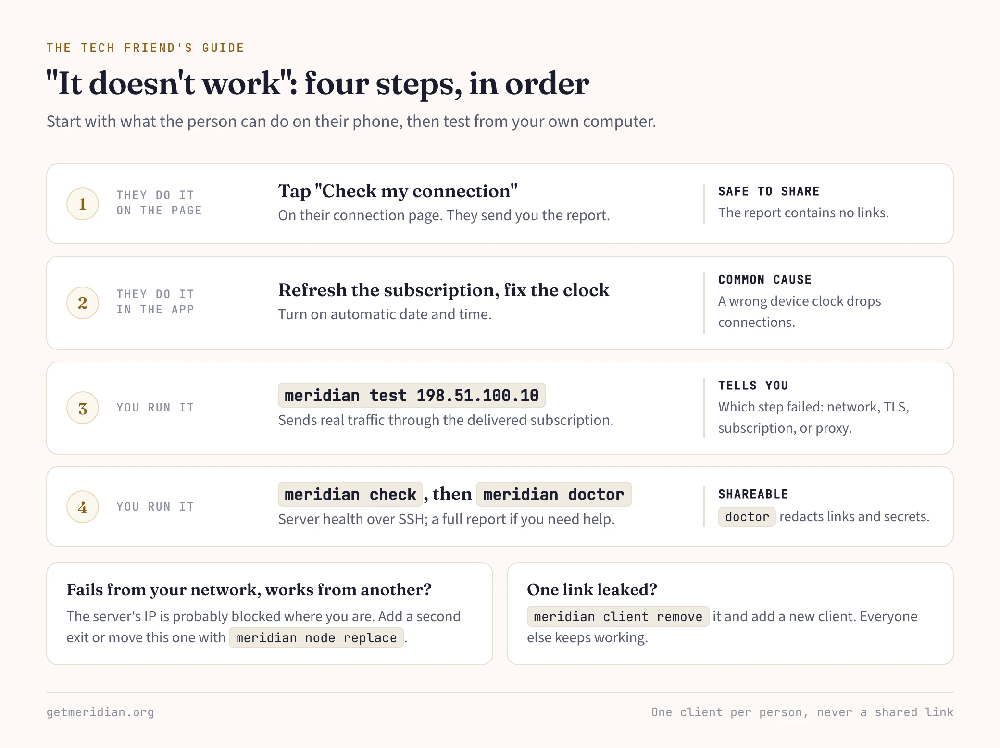

Someone in your family needs a working connection, and you are the one who knows computers. This guide covers the whole job: one server, a link per person, and what to do when they call.

## Why your own server

A commercial VPN puts everyone's traffic on addresses that thousands of other people share. Those ranges are well known, and they are the first to be blocked. Your own server has an address nobody else uses. It runs VLESS+Reality, which looks like an ordinary HTTPS visit to a real website. You pay for one small VPS and decide who gets in.

## What you need

- A VPS running Debian or Ubuntu, reachable over SSH with a key, as root or a user with passwordless sudo.
- A terminal on your own computer: macOS, Linux, or WSL on Windows.

Run Meridian on your computer, not on the VPS. It connects over SSH, keeps the credentials on your machine, and can test the server from the outside.

## Deploy

```bash
curl -sSf https://getmeridian.org/install.sh | bash
meridian deploy 198.51.100.10 --display-name "Family VPN" --client-name mom
```

`--display-name` labels every connection page, so your relatives know the link came from you. `--client-name` names the first person. Both are optional. If you prefer questions to flags, `meridian setup` walks you through the same choices.

The deploy hardens SSH, sets up the firewall and fail2ban, installs the Remnawave panel and Xray, and picks a camouflage site the server can reach. Clients get VLESS+Reality and XHTTP on TCP 443, plus Hysteria2 over UDP as a last fallback. Before it prints "Done", Meridian pushes real traffic through the delivered subscription. If the run is interrupted, run the same command again and it continues where it stopped.

## One client per person

```bash
meridian client add dad alice bob
```

Give every person their own client, never a shared one. Then you can cut off one lost phone without breaking everyone else's connection. Each client gets a connection page link, a QR code, and a subscription URL. To send someone their link again, run `meridian client show alice`.

By default the panel does not see your clients' real IP addresses. If you want per-user IP limits, deploy with `--client-ips`.

## What your relatives see

Send the connection page link through any messenger. The page:

- Recommends an app for their device, with Happ first.
- Adds the connection with one tap, or shows a QR code on a computer so they can scan it with their phone.
- Has a "Not connecting?" section with tips and a "Check my connection" test.

In the app, entries are named by country and method, such as "DE · Reality · Chrome". Apps refresh the subscription on their own, so servers you add later appear without a new link.

Treat each link like a key: anyone who has it can connect. If one leaks, run `meridian client reissue alice` to replace their link and page without deleting their account.

## When the phone rings

"It doesn't work" is the call you will get most. Work through it in this order:

1. Ask them to open their connection page, tap "Check my connection", and send you the report. The report contains no links, so it is safe to send over any chat.
2. Ask them to refresh the subscription in their app and turn on automatic date and time. A wrong device clock is a common cause of dropped connections.
3. From your own computer, run `meridian test 198.51.100.10`. It sends real traffic through the delivered subscription and tells you whether the network, TLS, subscription, or proxy step failed.
4. Run `meridian check` to inspect the server's health over SSH. If something is broken and you want help, `meridian doctor` collects a full report.

If `meridian test` fails from your network but works from another network, the server's IP is probably blocked where you are.



## Managing access

```bash
meridian client list            # everyone, with status, traffic, last seen
meridian client reissue bob     # leaked link: issue a new one, old one stops working
meridian client disable bob     # cut off now, same link later
meridian client enable bob
meridian client remove bob      # link and page are gone for good
```

`meridian panel` prints the address of the Remnawave web panel if you want traffic charts, limits, or expiry dates. Those settings belong to you, and Meridian's applies leave them alone. Add people with `meridian client add`, not in the panel, so they get a connection page.

## When the IP gets blocked

Buy a new VPS with a new IP. Then either add it as a second exit:

```bash
meridian node add 198.51.100.20 --name replacement
```

or move the blocked exit to it, keeping its keys and relays (take the exit ID from `meridian node list`):

```bash
meridian node replace EXIT_ID 198.51.100.20
```

Clients keep their accounts and links. Their apps pick up the new server on the next subscription refresh. Keep the old server for a while, because blocks are sometimes lifted.

Two upgrades make the next block hurt less:

- **A domain** (`--domain`) adds WebSocket and XHTTP through Cloudflare's CDN. These keep working when the server's IP is blocked.
- **A relay** on a server inside the country (`meridian relay add`) gives users an entry point that stays reachable when foreign IPs are cut off.

Back up `~/.config/meridian/` on your computer. It holds the topology and panel access, and without it you can't manage the fleet.

Next: [Getting started](/en/getting-started/) for the full first deploy, and [IP blocked recovery](/en/recovery/) before you need it.
