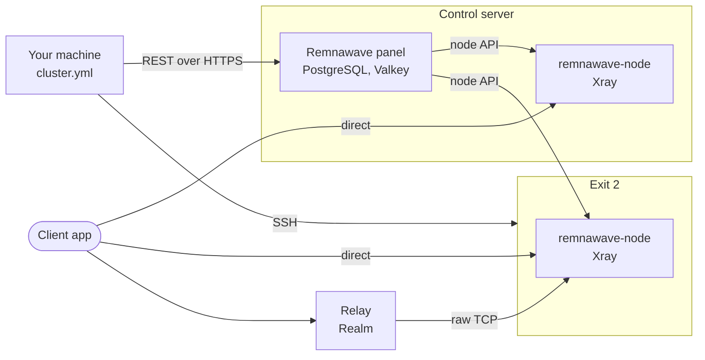
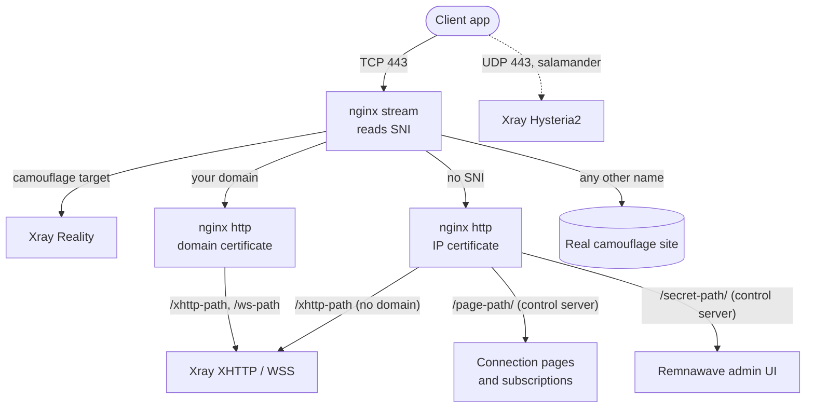
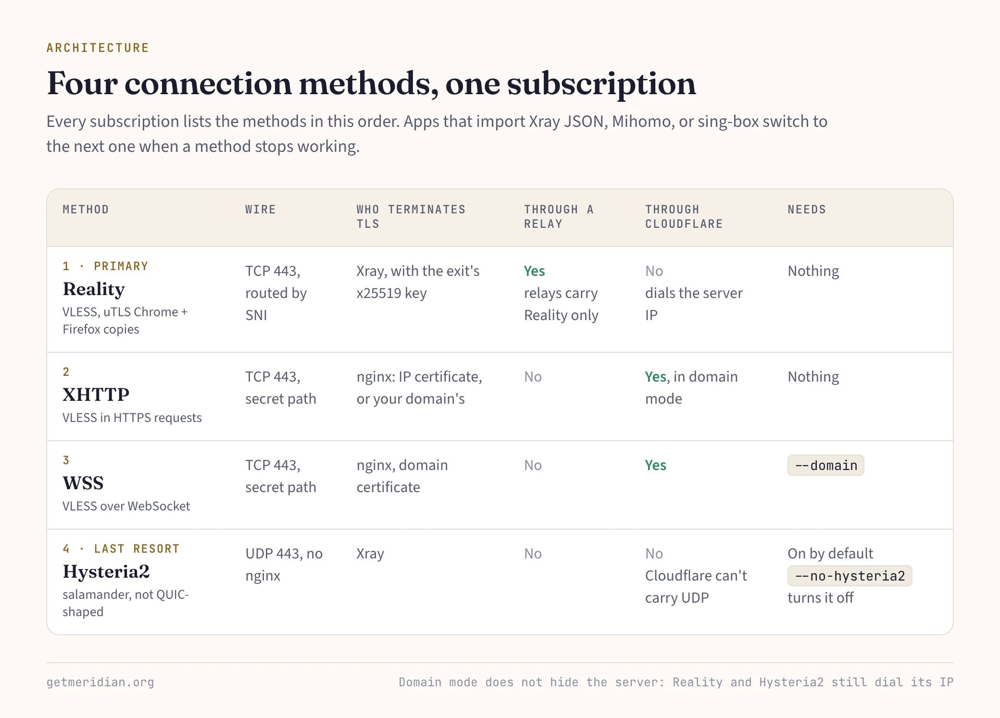
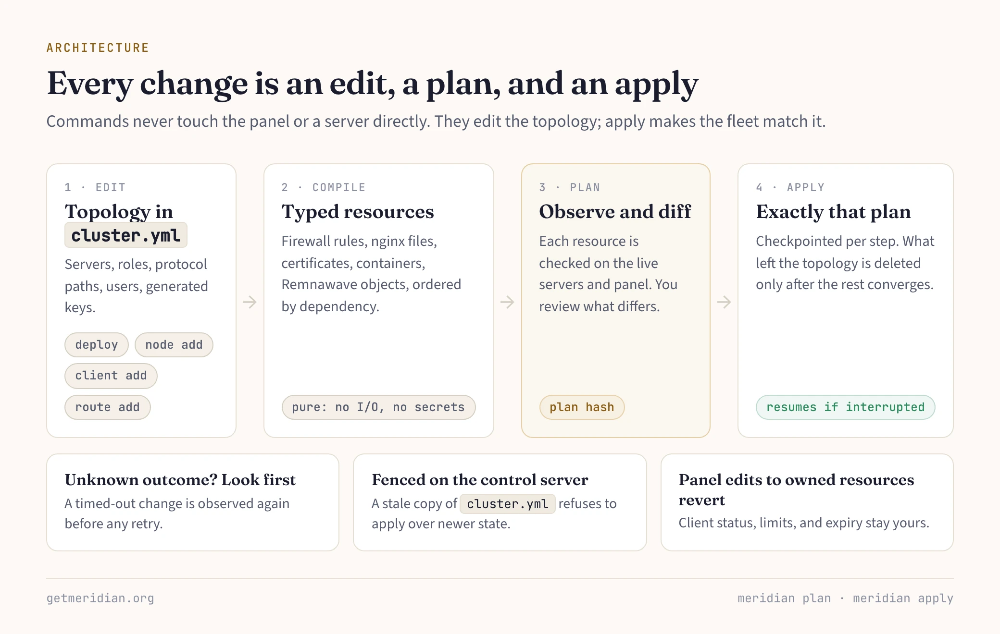

A Meridian fleet has three layers. nginx owns public TCP 443 and decides where each connection goes. Xray, managed by Remnawave, carries the traffic. A topology file on your machine describes the whole fleet, and `meridian plan` and `meridian apply` make the servers match it.

## Roles

Every server has one or more roles:

- **Control server.** Runs the Remnawave panel: the backend (API and admin UI) with PostgreSQL and Valkey, plus the subscription page. Client accounts, keys, and traffic live in its database. It is usually an exit too.
- **Exit.** Where traffic leaves for the internet. Each exit runs one `remnawave/node` container, which runs Xray. It registers with the panel through a per-node secret, and the panel pushes configuration to it over the node API.
- **Relay.** A TCP forwarder (Realm) on an address users can still reach. No Docker, no panel, no Xray.
- **Gateway.** Routes traffic between exits by rule, to one exit or to a health-checked pool.

`meridian deploy IP` builds the smallest fleet: one server that is both control server and exit. `meridian node add` adds exits. `meridian relay add` adds relays. The `meridian setup` wizard builds any shape, including multi-hop relay chains and gateways.

The CLI talks to the panel's REST API directly over HTTPS. nginx reverse-proxies the panel on a secret path on port 443, so no SSH tunnel is needed. Connection pages and subscriptions use a separate path, so a shared link never reveals the panel's.

## One port, routed by SNI

Each exit runs nginx's stream module on TCP 443. It reads the server name (SNI) from the TLS Client Hello and forwards the raw TCP stream without decrypting it. The routing table is a map from SNI to backend:

- **The camouflage target** goes to Xray's Reality listener.
- **Your domain**, in domain mode, goes to an internal nginx TLS server that holds the domain certificate.
- **No SNI**, sent by a client that dialed the bare IP, goes to an internal TLS server with a Let's Encrypt IP certificate. On the control server, this server also hosts the panel, connection pages, and subscriptions.
- **Any other name** is forwarded to the real camouflage site on its port 443.

A scanner that sends a random SNI therefore gets a real website instead of a proxy error.

Xray's backend listeners use ports allocated per exit and protocol from a hash, so they stay stable across re-applies. UFW blocks them from the internet. Publicly, a server opens its SSH port, TCP 443, UDP 443 when Hysteria2 is on, and TCP 80 for ACME challenges where it issues certificates.

Because every TCP connection reaches Xray through nginx, the panel records the server's own address, not your users'. `--client-ips` turns on the PROXY protocol between nginx and Xray when you need per-user IP limits.

## Four connection methods

**Reality** is the primary path. The client sends a Client Hello that names the camouflage target, shaped by uTLS to match Chrome's. Firefox-shaped copies are listed as backup entries. A client holding the exit's x25519 public key authenticates and gets a VLESS tunnel. A prober without the key is passed through to the real site and sees its genuine certificate.

The best camouflage target is a site hosted in the server's own network, because the SNI and the IP then belong together. On a first deploy, Meridian scans the server's subnet for such sites, then falls back to well-known ones such as `www.google.com`. It keeps a target only after real traffic passes through it, because some large sites fail Reality's checks.

**XHTTP** carries VLESS inside ordinary HTTPS requests on a secret path. Without a domain, it uses the IP certificate. nginx terminates TLS and hands the path to Xray.

**WSS** is VLESS over WebSocket on your own domain. It exists only in domain mode.

**Hysteria2** is the UDP last resort for lossy networks. Xray listens on UDP 443 directly; nginx is not involved. Salamander obfuscation makes the packets look random instead of like QUIC. It is on by default, and `--no-hysteria2` turns it off.

Every subscription lists all methods in order. Apps that import the Xray JSON, Mihomo, or sing-box format switch to the next method when one stops working. Other apps show each method as a separate entry. Users install apps such as Happ, FlClashX, or Clash Mi from their connection page and scan a QR code. There is no Meridian client app.

## Domain mode

`--domain` moves XHTTP to your domain and adds WSS there, with a Let's Encrypt certificate from acme.sh. When Cloudflare proxies the record, both paths travel through its CDN and keep working if the server's IP is blocked.

Domain mode does not hide the server. The Reality path still dials the IP, and so does Hysteria2, because Cloudflare can't carry UDP. Hysteria2 uses the domain only for its certificate. The panel and connection pages stay on the IP certificate; the domain carries only proxy paths.

## Relays

A relay runs Realm, listening on 443 by default and forwarding raw TCP to the exit's Reality listener. TLS runs end to end between client and exit, so the relay never holds keys or sees plaintext. Relays carry Reality only. XHTTP, WSS, and Hysteria2 stay on the exit and remain in the same subscription.

A relay can announce its own SNI with `--sni`. The exit adds that name to its Reality listener, with the same keys, and gives the relay a separate listener that accepts only the relay's last hop. Nothing on a relay host names Meridian: services run as `netfwd-*` units with configs in `/etc/netfwd/`.

## Topology, plan, and apply

`cluster.yml` on your machine holds the topology: control server, exits, relays, gateways, protocol paths, the list of users, and the keys Meridian generated. Commands that change the fleet (`deploy`, `setup`, `node add`, `relay add`, `client add`, `route add`) edit that topology. None of them changes the panel or a server directly.

A pure compiler turns the topology into typed resources: firewall rules, nginx files, certificates, containers, and Remnawave profiles, hosts, users, and templates. They are ordered by dependency and identified by a plan hash. The compiler does no I/O and generates no secrets.

`meridian plan` observes each resource on the live servers and panel and reports what differs. `meridian apply` shows the plan hash, then applies exactly that plan, checkpointing every step so an interrupted apply resumes. If a change times out, Meridian observes the resource again before retrying. Resources that left the topology are deleted only after the new plan converges. If you edit a resource Meridian owns in the panel, the next apply restores it. Client status, limits, and expiry stay yours.

The control server keeps a fence record with the fleet's last committed generation. A stale copy of `cluster.yml` on another machine refuses to apply instead of overwriting newer state.

Deploy ends with a test. Before it prints "Done", it pushes real traffic through the delivered subscription. `meridian test` does the same later: it fetches a client's delivered Xray config and runs it, without rebuilding credentials locally.

The [architecture reference](/en/architecture/) lists every port, container, and file path.
