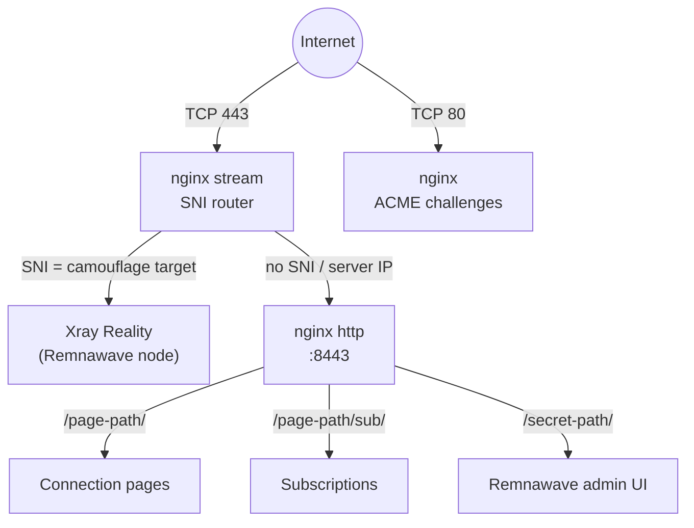
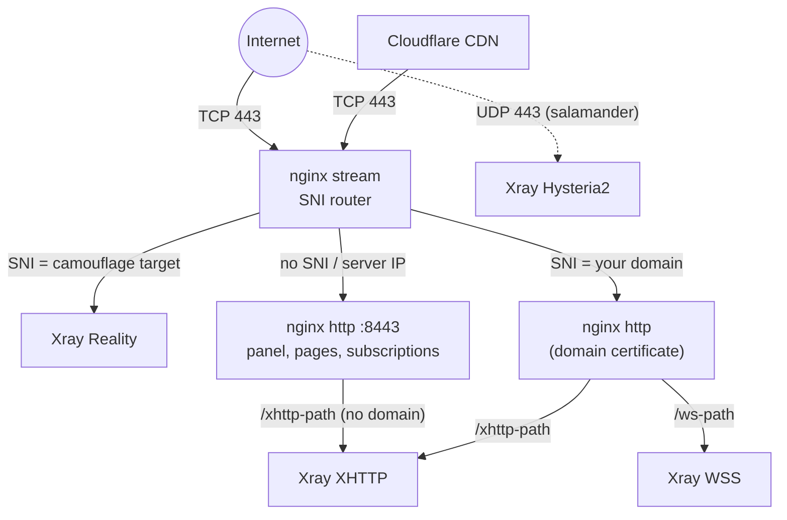

## Technology stack

- **VLESS+Reality** (Xray-core) — the primary protocol. It impersonates a real TLS website: anyone probing the server sees that site's genuine certificate (preferably a site hosted next to your server). Only clients with the right key reach the proxy.
- **XHTTP** (Xray-core) — a TLS path on your domain, or on the server's IP with a Let's Encrypt IP certificate when there is no domain.
- **WSS** (Xray-core) — a TLS path on your own domain, added in domain mode. With Cloudflare proxying the domain, it and XHTTP travel through the CDN and survive an IP block.
- **Hysteria2** (Xray-core) — the UDP/443 last resort for lossy networks, wrapped in salamander obfuscation so it doesn't look like QUIC. On by default (`--no-hysteria2` turns it off).
- **Remnawave** — the panel stack: `remnawave/backend` (API and admin UI, with PostgreSQL and Valkey) on the control-plane server, `remnawave/node` (runs Xray) on every exit, and `remnawave/subscription-page`. Meridian pins tested versions and talks to the panel over its REST API.
- **nginx** — owns public TCP/443. Its stream module routes connections by SNI without terminating TLS; its http module terminates TLS for the panel, connection pages, subscriptions, and domain paths. Certificates come from Let's Encrypt via [acme.sh](https://github.com/acmesh-official/acme.sh).
- **Realm** — the TCP forwarder on relay servers.
- **uTLS** — client connections copy a browser's TLS Client Hello (Chrome, with Firefox copies as backup entries), so they look like ordinary browser traffic.

## Service topology

### Single server (`meridian deploy IP`)

nginx stream **does not** terminate TLS. It reads the SNI from the Client Hello and forwards the raw TCP stream. The panel, connection pages, and subscriptions are served with a Let's Encrypt certificate for the server's IP (short-lived, renewed automatically).

Shared links live under the connection-page path: pages at `/<page-path>/<id>/`, subscriptions at `/<page-path>/sub/<id>`. The admin panel sits on a separate secret path that shared links never reveal.

### Domain mode

The domain carries only the proxy paths; the panel and pages stay on the IP certificate.

### Relays

A relay forwards raw TCP from a domestic IP to the exit's Reality listener. Encryption is end to end between client and exit; the relay never sees plaintext. Relays carry Reality only. `meridian setup` can also build multi-hop relay chains and routing gateways that pick an exit (or a health-checked pool of exits) by rule.

## How Reality works

1. Each exit has an **x25519 keypair**. Clients get the public key; the private key stays on the server.
2. The client connects on port 443 with a TLS Client Hello naming the camouflage target (e.g. `www.google.com`).
3. To an observer, this is an ordinary HTTPS connection to that site.
4. A **prober** without the key is passed through to the real site and sees its valid certificate.
5. A client with valid authentication gets the VLESS tunnel.
6. **uTLS** makes the Client Hello match Chrome's, defeating TLS fingerprinting.

## State model

- **Topology** — `~/.config/meridian/cluster.yml` on your machine holds the reviewed topology (control plane, exits, relays, gateways, protocol paths, and the list of users), panel access, and the keys Meridian generated. `meridian setup`, `deploy`, `client add`, `node add`, and `relay add` change it; don't edit it by hand.
- **Clients** — accounts, keys, status, and traffic live in the Remnawave database on the control-plane server.
- **Saved servers** — `~/.config/meridian/servers.json` holds SSH connection details.

## Plan and apply

Meridian turns the topology into a list of resources: firewall rules, nginx routes, containers, Remnawave profiles, hosts, users, and templates. `meridian plan` observes each one on the live servers and panel and reports what needs repair. `meridian apply` applies the exact plan it showed, checkpointing every step so an interrupted apply resumes safely. Resources whose outcome is uncertain are re-observed before any retry.

Anything in the topology can be added and removed: users, protocol paths, exits, relays, and routing gateways. After the new plan converges, apply deletes what left it (panel users, hosts, and nodes, nginx files, Realm services, certificates, firewall rules). The control server is the exception: its address is part of every subscription URL, so it leaves only with `meridian teardown`.

Panel edits to resources Meridian owns show up in `meridian plan` and are restored by the next apply. Remnawave settings Meridian doesn't manage are left alone.

## Port assignments

| Port | Service | Scope |
|------|---------|-------|
| 443/TCP | nginx stream (SNI router) | Public |
| 443/UDP | Xray Hysteria2 (on by default) | Public |
| 80/TCP | nginx (ACME challenges) | Public |
| 8443 | nginx http (panel, pages, subscriptions) | Internal |
| 8444 | nginx http, PROXY-protocol listener (used with `--client-ips`) | Internal |
| 3000 | Remnawave backend (admin UI + API) | localhost |
| 3010 | Remnawave node API | host network |
| 3020 | Remnawave subscription page | localhost |
| 10000+ | Xray Reality (per-exit) | host network, firewalled |
| 20000+ | Xray WSS (domain mode, per-exit) | host network, firewalled |
| 30000+ | Xray XHTTP (per-exit) | host network, firewalled |

Backend Xray ports are reached through nginx; UFW blocks them from the internet. Relay servers open only SSH and their listen port.

## Docker containers

**On the control-plane server:**
- `remnawave` — backend API and admin UI on `127.0.0.1:3000`
- `remnawave-db` — PostgreSQL (users, hosts, profiles)
- `remnawave-redis` — Valkey cache
- `remnawave-subscription-page` — subscription frontend on `127.0.0.1:3020`
- `remnawave-node` — Xray, in host networking with `NET_ADMIN`

**On every other exit:**
- `remnawave-node` only, registered with the panel through a per-node secret

## Teardown

`meridian teardown IP` removes the panel and node containers and volumes, Meridian's nginx files, certificates, Realm services, and firewall rules (plus 3x-ui from Meridian 3.x). Docker and system packages stay. On a single-server deployment it also removes the local `cluster.yml`. In a multi-server fleet it refuses servers that still have a role.

## File locations

### On the control-plane server
- `/opt/remnawave/` — panel compose file and `.env`
- `/etc/nginx/stream.d/meridian-v4-*.conf` — SNI routing
- `/etc/nginx/sites-available/meridian-v4-*.conf` — TLS sites and reverse proxy
- `/etc/ssl/meridian/` — certificates

### On each exit
- `/opt/remnanode/` — node compose file and `.env`

### On each relay
- `/etc/netfwd/` — Realm configuration, run from `/usr/local/bin/netfwd` by `netfwd-*` systemd services. Relay hosts carry no Meridian-named units, paths, or firewall comments (`fw-*`)

### On your machine
- `~/.config/meridian/cluster.yml` — topology, panel access, keys
- `~/.config/meridian/cluster.yml.bak` — backup taken before destructive operations
- `~/.config/meridian/servers.json` — saved SSH servers
- `~/.config/meridian/setup.json` — `meridian setup` progress (no secrets)
- `~/.config/meridian/ssh/meridian_ed25519` — managed SSH key, when generated
- `~/.config/meridian/cache/` — update-check cache

The directory follows `$XDG_CONFIG_HOME` when it is set, and `MERIDIAN_HOME` overrides it. While `~/.config/meridian/` doesn't exist, Meridian also uses `~/.meridian-v4/` or `~/.meridian/` when either holds a fleet (it has a `servers.json`). Meridian 3.x state in `~/.meridian/` is never touched.
