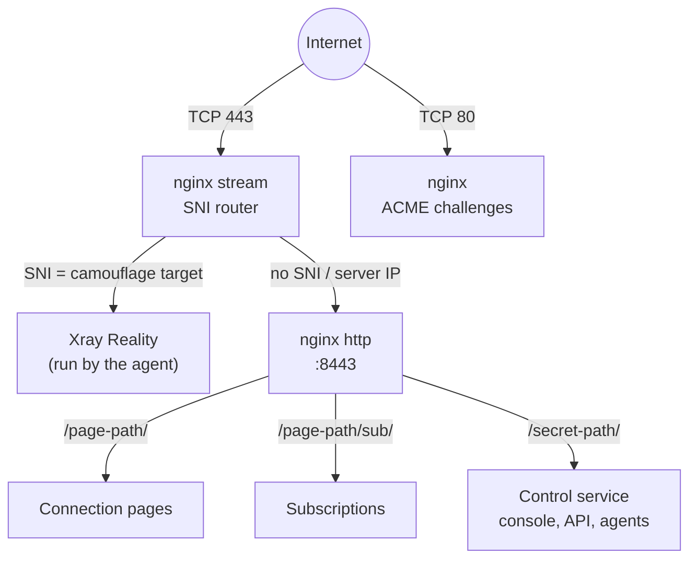
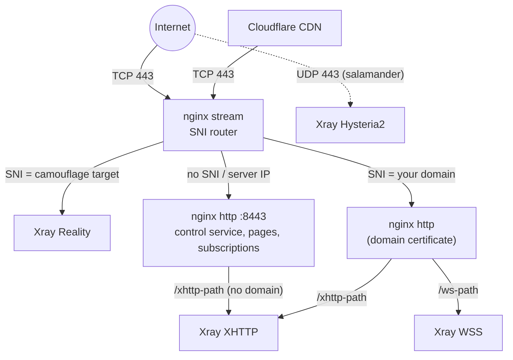
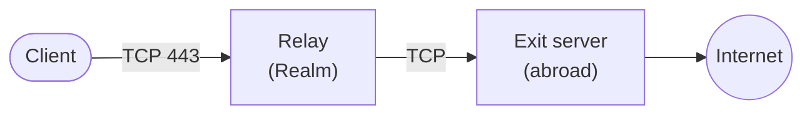
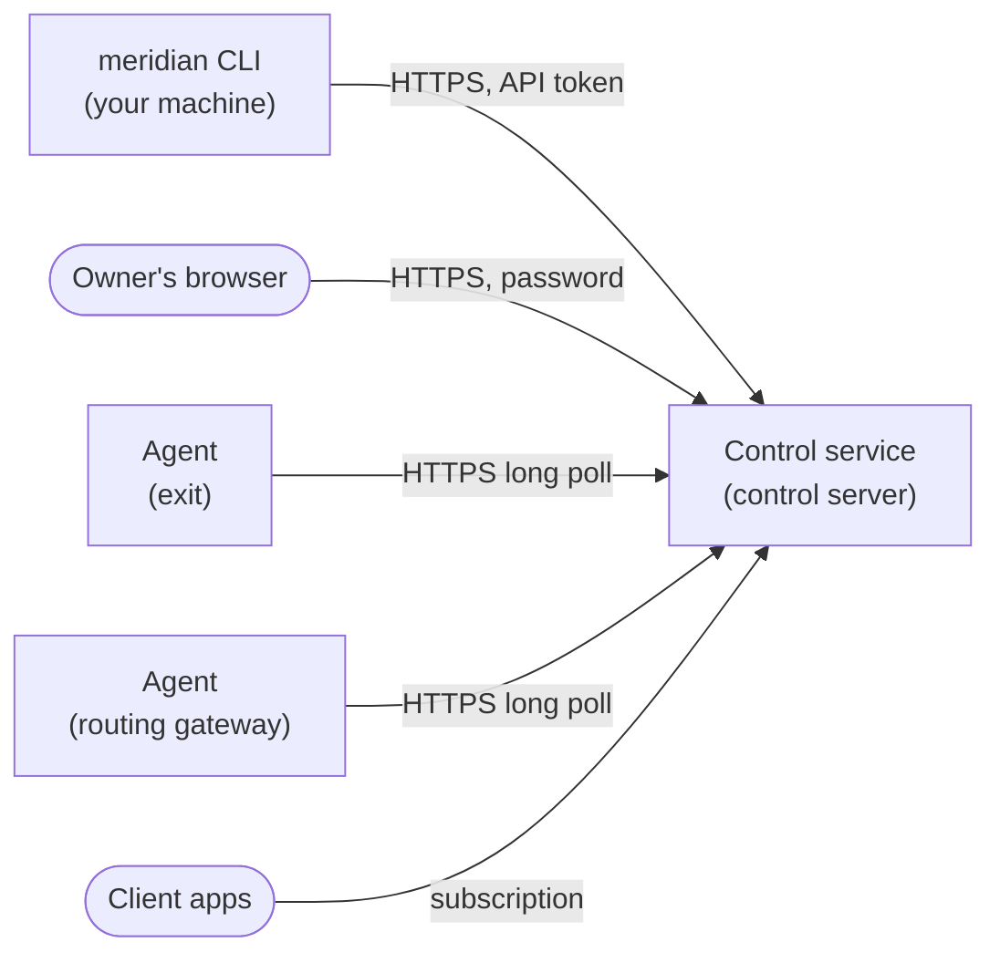

## Technology stack

- **VLESS+Reality** (Xray-core) — the primary protocol. It impersonates a real TLS website: anyone probing the server sees that site's genuine certificate (preferably a site hosted next to your server). Only clients with the right key reach the proxy.
- **XHTTP** (Xray-core) — a TLS path on your domain, or on the server's IP with a Let's Encrypt IP certificate when there is no domain.
- **WSS** (Xray-core) — a TLS path on your own domain, added in domain mode. With Cloudflare proxying the domain, it and XHTTP travel through the CDN and survive an IP block.
- **Hysteria2** (Xray-core) — the UDP/443 last resort for lossy networks, wrapped in salamander obfuscation so it doesn't look like QUIC. On by default (`--no-hysteria2` turns it off).
- **Control service** — Meridian's own service (`meridian serve`) on the control server. It keeps users, traffic, revisions, and backups in one SQLite file, serves every subscription format, and hosts the owner's web console. It runs as a systemd unit, with no Docker and no database server.
- **Node agent** — a small static Rust binary on every exit and routing gateway. It dials the control service over HTTPS on 443, verifies the signed document it receives, and runs Xray as a separate service. Nodes open no management port.
- **nginx** — owns public TCP/443. Its stream module routes connections by SNI without terminating TLS; its http module terminates TLS for the control service, connection pages, subscriptions, and domain paths. Certificates come from Let's Encrypt via [acme.sh](https://github.com/acmesh-official/acme.sh).
- **Realm** — the TCP forwarder on relay servers.
- **uTLS** — client connections copy a browser's TLS Client Hello (Chrome, with Firefox copies as backup entries), so they look like ordinary browser traffic.

## Service topology

### Single server (`meridian deploy IP`)

nginx stream **does not** terminate TLS. It reads the SNI from the Client Hello and forwards the raw TCP stream. The control service, connection pages, and subscriptions are served with a Let's Encrypt certificate for the server's IP (short-lived, renewed automatically).

Shared links live under the connection-page path: pages at `/<page-path>/<id>/`, subscriptions at `/<page-path>/sub/<id>`. The control service's console, API, and agent endpoint sit on a separate secret path that shared links never reveal.

### Domain mode

The domain carries only the proxy paths; the control service and pages stay on the IP certificate.

### Relays

A relay forwards raw TCP from a domestic IP to the exit's Reality listener. Encryption is end to end between client and exit; the relay never sees plaintext. Relays carry Reality only. `meridian setup` can also build multi-hop relay chains and routing gateways that pick an exit (or a health-checked pool of exits) by rule, or send matching traffic directly from the gateway.

### Control service and agents

Every connection points at the control service; nothing connects to a node. Each agent dials out over HTTPS on 443, waits for a new document, and reports what it applied and the traffic it counted. The control service signs every node document with the fleet's own key, and the agent refuses one that doesn't verify, so a forged or replayed document changes nothing. A new node joins with a single-use enrollment token that Meridian hands it over SSH, then holds a certificate from the fleet's own authority.

Traffic is counted once per report, even when a report is resent. By default the service keeps lifetime totals and last seen, without client IP addresses. Optional [Privacy](/en/privacy/) settings add daily person/server totals with retention and device fingerprints or full device details.

## How Reality works

1. Each exit has an **x25519 keypair**. Clients get the public key; the private key stays on the server.
2. The client connects on port 443 with a TLS Client Hello naming the camouflage target (e.g. `www.google.com`).
3. To an observer, this is an ordinary HTTPS connection to that site.
4. A **prober** without the key is passed through to the real site and sees its valid certificate.
5. A client with valid authentication gets the VLESS tunnel.
6. **uTLS** makes the Client Hello match Chrome's, defeating TLS fingerprinting.

## State model

- **Topology** — `~/.config/meridian/cluster.yml` on your machine holds the reviewed topology (control server, exits, relays, gateways, protocol paths, and the list of users), the control service's address and API token, and the keys Meridian generated. `meridian setup`, `deploy`, `client add`, `node add`, and `relay add` change it; don't edit it by hand.
- **Clients** — accounts, keys, status, limits, and traffic live in the control service's database on the control server.
- **Revisions** — the control service records every reviewed apply: who made it, its plan, and whether it applied. `meridian fleet history` lists them.
- **Snapshots** — after every change, each machine that manages the fleet saves an encrypted copy of the control service's state in `snapshots/`, readable with that machine's key or the recovery key. See [Recovery](/en/recovery/#control-server-lost).
- **Saved servers** — `~/.config/meridian/servers.json` holds SSH connection details.

## Plan and apply

Meridian turns the topology into a list of resources: firewall rules, nginx routes, certificates, Realm services, node agents, the documents each node runs, client endpoints, and users. `meridian plan` observes each one on the live servers and the control service and reports what needs repair. `meridian apply` applies the exact plan it showed, checkpointing every step so an interrupted apply resumes safely. Resources whose outcome is uncertain are re-observed before any retry. An apply holds a lease in the control service, so two machines never apply at once, and a machine whose copy of the fleet is behind refuses until it catches up.

Anything in the topology can be added and removed: users, protocol paths, exits, relays, and routing gateways. After the new plan converges, apply deletes what left it (users, client endpoints, node agents and their Xray, nginx files, Realm services, certificates, firewall rules). The control server is the exception: its address is part of every subscription URL, so it leaves only with `meridian teardown`, or moves with `meridian restore`.

Clients' status, limits, and expiry belong to you, from the CLI or the console; applies never change them.

## Port assignments

| Port | Service | Scope |
|------|---------|-------|
| 443/TCP | nginx stream (SNI router) | Public |
| 443/UDP | Xray Hysteria2 (on by default) | Public |
| 80/TCP | nginx (ACME challenges) | Public |
| 8443 | nginx http (control service, pages, subscriptions) | Internal |
| 8444 | nginx http, PROXY-protocol listener | Internal |
| 3000 | Control service (console, API, agents, subscriptions) | localhost |
| 10000+ | Xray Reality (per-exit) | host network, firewalled |
| 20000+ | Xray WSS (domain mode, per-exit) | host network, firewalled |
| 30000+ | Xray XHTTP (per-exit) | host network, firewalled |

Backend Xray ports are reached through nginx; UFW blocks them from the internet. Agents only dial out, so no node opens a management port. Relay servers open only SSH and their listen port.

## Services

Unit and directory names are neutral, so a host reading `systemctl` or `/opt` sees nothing that names proxy software. `meridian check` and `meridian doctor` show the role behind each name. Servers need no Docker.

**On the control server:**
- `ctld` — the control service, `meridian serve` from a pinned install in `/opt/ctld`, on `127.0.0.1:3000` behind nginx

**On every exit and routing gateway** (the control server too, when it is also an exit):
- `netagent` — the node agent
- `netcore` — Xray, started and configured by the agent

**On every relay:**
- `netfwd-*` — one Realm service per relay hop

The agent is a static binary for x86-64 and ARM64 servers. Meridian upgrades it in place when a new release brings a new build, and keeps the node's identity.

## Teardown

`meridian teardown IP` removes the control service, the agent and Xray, Meridian's nginx files, certificates, Realm services, and firewall rules (plus 3x-ui from Meridian 3.x). System packages stay. On a single-server deployment it also removes the local `cluster.yml`. In a multi-server fleet it refuses servers that still have a role.

## File locations

### On the control server
- `/opt/ctld/` — the control service's pinned install
- `/etc/ctld/config.json` — its configuration
- `/var/lib/ctld/` — its database (users, traffic, revisions, backup keys)
- `/etc/nginx/stream.d/meridian-v4-*.conf` — SNI routing
- `/etc/nginx/sites-available/meridian-v4-*.conf` — TLS sites and reverse proxy
- `/etc/ssl/meridian/` — certificates

### On each exit and routing gateway
- `/usr/local/bin/netagent` — the agent
- `/etc/netagent/` — its enrollment and the Xray configuration it writes
- `/var/lib/netagent/` — its keys, certificate, and state
- `/usr/local/lib/netagent/` — Xray

### On each relay
- `/etc/netfwd/` — Realm configuration, run from `/usr/local/bin/netfwd` by `netfwd-*` systemd services. Relay hosts carry no Meridian-named units, paths, or firewall comments (`fw-*`)

### On your machine
- `~/.config/meridian/cluster.yml` — topology, control service access, keys
- `~/.config/meridian/cluster.yml.bak` — backup taken before destructive operations
- `~/.config/meridian/servers.json` — saved SSH servers
- `~/.config/meridian/setup.json` — `meridian setup` progress (no secrets)
- `~/.config/meridian/snapshots/` — encrypted snapshots of the control service
- `~/.config/meridian/device.key` — this machine's key for those snapshots
- `~/.config/meridian/ssh/meridian_ed25519` — managed SSH key, when generated
- `~/.config/meridian/cache/` — update-check cache

The directory follows `$XDG_CONFIG_HOME` when it is set, and `MERIDIAN_HOME` overrides it. While `~/.config/meridian/` doesn't exist, Meridian also uses `~/.meridian-v4/` or `~/.meridian/` when either holds a fleet (it has a `servers.json`). Meridian 3.x state in `~/.meridian/` is never touched.

Several fleets can share one machine as contexts (`meridian context`). That directory is the `default` context; another context keeps its own `cluster.yml`, backup, `servers.json`, `setup.json`, snapshots, and device key in `contexts/NAME/`, while the SSH key, the update-check cache, the language choice, and the local Xray runtime stay shared. `--context`, then `MERIDIAN_CONTEXT`, then the saved `current-context` choose one; `MERIDIAN_HOME` pins a single fleet.
