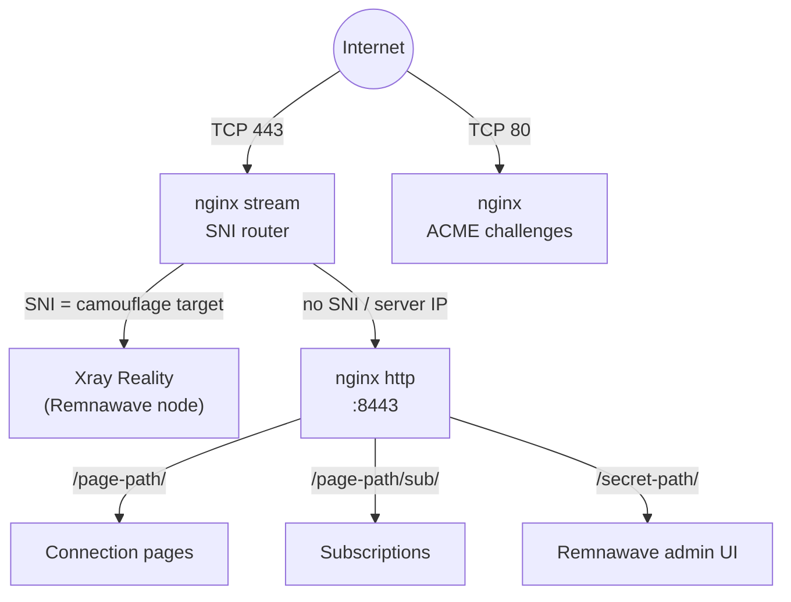
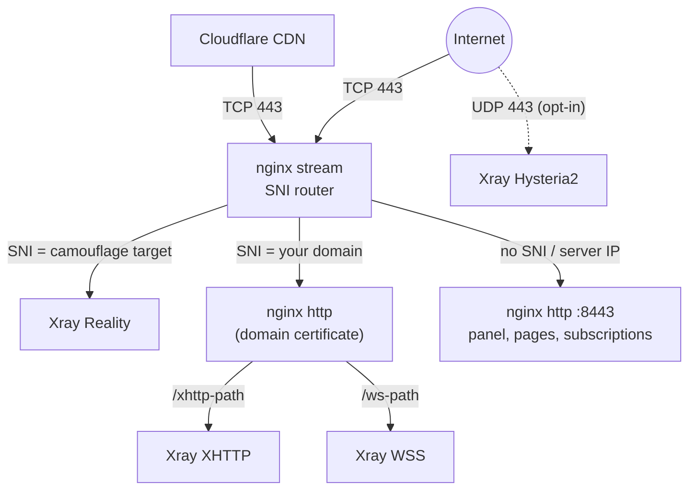

## پشته فناوری

- **VLESS+Reality** (Xray-core) — پروتکل اساسی. خود را به‌عنوان وب‌سایت TLS واقعی جا می‌زند: هر کسی که سرور را probe می‌کند گواهینامه واقعی آن سایت را می‌بیند (برای مثال، گواهینامه Google). فقط کلاینت‌هایی با کلید صحیح به proxy دسترسی دارند.
- **XHTTP و WSS** (Xray-core) — مسیرهای TLS روی دامنه‌های خود، در حالت domain اضافه شده. با proxying دامنه از طریق Cloudflare، آن‌ها از CDN عبور می‌کنند و از IP block جان سالم به‌در می‌برند.
- **Hysteria2** (Xray-core) — مسیر اختیاری UDP/443 روی دامنه شما برای شبکه‌های lossy. به‌طور پیش‌فرض خاموش است.
- **Remnawave** — پشته پنل: `remnawave/backend` (API و رابط مدیر، با PostgreSQL و Valkey) روی سرور control-plane، `remnawave/node` (Xray را اجرا می‌کند) روی هر exit، و `remnawave/subscription-page`. Meridian نسخه‌های تست‌شده را pin می‌کند و با پنل از طریق REST API صحبت می‌کند.
- **nginx** — TCP/443 عمومی را در اختیار دارد. ماژول stream بدون خاتمه TLS اتصالات را بر اساس SNI مسیریابی می‌کند؛ ماژول http برای پنل، صفحات اتصال، اشتراک و مسیرهای domain TLS را خاتمه می‌دهد. گواهینامه‌ها از Let's Encrypt از طریق [acme.sh](https://github.com/acmesh-official/acme.sh) می‌آیند.
- **Realm** — TCP forwarder روی سرورهای relay.
- **uTLS** — اتصالات کلاینت Chrome's TLS Client Hello را کپی می‌کنند، بنابراین مثل ترافیق معمولی مرورگر به نظر می‌رسند.

## توپولوژی سرویس

### سرور تنها (`meridian deploy IP`)

nginx stream TLS را خاتمه **نمی‌دهد**. SNI را از Client Hello می‌خواند و جریان TCP خام را forward می‌کند. پنل، صفحات اتصال و اشتراک با گواهینامه Let's Encrypt برای IP سرور (کوتاه‌مدت، تجدید خودکار) ارائه می‌شوند.

پیوندهای به‌اشتراک‌گذاری شده زیر مسیر صفحه اتصال زندگی می‌کنند: صفحات در `/<page-path>/<id>/`، اشتراک در `/<page-path>/sub/<id>`. پنل مدیریت روی مسیر مخفی جداگانه قرار دارد که پیوندهای به‌اشتراک‌گذاری شده هیچ‌گاه آن را افشا نمی‌کنند.

### حالت Domain

دامنه فقط مسیرهای proxy را حمل می‌کند؛ پنل و صفحات روی گواهینامه IP می‌مانند.

### Relays

relay ترافیک TCP خام را از IP داخلی به listener Reality exit منتقل می‌کند. رمزنگاری از انتها تا انتها بین کلاینت و exit است؛ relay هرگز plaintext را نمی‌بیند. Relays تنها Reality را حمل می‌کنند. `meridian setup` می‌تواند زنجیرهای relay چند‌hop و درب‌های routing را بسازد که exit (یا풀 سلامت‌بررسی‌شده) را توسط قانون انتخاب می‌کند.

## نحوه کار Reality

1. هر exit یک **x25519 keypair** دارد. کلاینت‌ها کلید عمومی را دریافت می‌کنند؛ کلید خصوصی روی سرور می‌ماند.
2. کلاینت روی پورت 443 با TLS Client Hello که نام هدف camouflage را شامل است (به مثال `www.google.com`) اتصال برقرار می‌کند.
3. برای ناظر، این اتصال عادی HTTPS به آن سایت است.
4. **prober** بدون کلید از طریق به سایت واقعی عبور می‌کند و گواهینامه معتبر آن را می‌بیند.
5. کلاینت با احراز هویت معتبر تونل VLESS را دریافت می‌کند.
6. **uTLS** Client Hello را مطابق Chrome می‌سازد، TLS fingerprinting را شکست می‌دهد.

## مدل State

- **Topology** — `~/.meridian/cluster.yml` روی ماشین شما تدوین شده topology (control plane، exits، relays، gateways، مسیرهای پروتکل و لیست کاربران)، دسترسی پنل و کلیدهایی که Meridian تولید کرد را شامل می‌شود. `meridian setup`، `deploy`، `client add`، `node add` و `relay add` آن را تغییر می‌دهند؛ دستی ویرایش نکنید.
- **Clients** — حساب‌ها، کلیدها، وضعیت و ترافیق در دیتابیس Remnawave روی سرور control-plane زندگی می‌کنند.
- **Saved servers** — `~/.meridian/servers.json` جزئیات اتصال SSH را شامل می‌شود.

## Plan و apply

Meridian topology را به لیست منابع تبدیل می‌کند: قوانین firewall، مسیرهای nginx، containers، پروفایل‌های Remnawave، میزبان‌ها، کاربران و templates. `meridian plan` هر کدام را روی سرورها و پنل زندگی مشاهده می‌کند و گزارش می‌کند چه نیاز به تعمیر دارد. `meridian apply` دقیقاً plan را اعمال می‌کند که نشان داد، هر مرحله را checkpoint می‌کند تا interrupted apply امن از سر شروع شود. منابعی که نتیجه آن‌ها نامشخص است مجدداً مشاهده می‌شوند پیش از هر تلاش.

کاربران و مسیرهای پروتکل می‌توانند اضافه و حذف شوند؛ بعد از اینکه نقشه جدید همگرا شود، apply حذف می‌کند آن‌های که آن را ترک کردند (کاربران پنل و میزبان‌ها، فایل‌های nginx، قوانین firewall). حذف exit، relay یا routing gateway از fleet در حال اجرا برای اکنون رد می‌شود.

ویرایش‌های پنل برای منابعی که Meridian مالک است در `meridian plan` نشان می‌دهند و توسط apply بعدی بازگردانده می‌شوند. تنظیمات Remnawave که Meridian مدیریت نمی‌کند تنهایشان می‌مانند.

## اختصاص Port

| Port | Service | Scope |
|------|---------|-------|
| 443/TCP | nginx stream (SNI router) | Public |
| 443/UDP | Xray Hysteria2 (opt-in) | Public |
| 80/TCP | nginx (ACME challenges) | Public |
| 8443 | nginx http (panel, pages, subscriptions) | Internal |
| 3000 | Remnawave backend (admin UI + API) | localhost |
| 3010 | Remnawave node API | host network |
| 3020 | Remnawave subscription page | localhost |
| 10000+ | Xray Reality (per-exit) | host network, firewalled |
| 20000+ | Xray WSS (domain mode, per-exit) | host network, firewalled |
| 30000+ | Xray XHTTP (domain mode, per-exit) | host network, firewalled |

Backend Xray ports از طریق nginx قابل دسترسی است؛ UFW آن‌ها را از اینترنت block می‌کند. سرورهای Relay فقط SSH و پورت شنوندگی خود را باز می‌کنند.

## Docker containers

**روی سرور control-plane:**
- `remnawave` — backend API و admin UI روی `127.0.0.1:3000`
- `remnawave-db` — PostgreSQL (users, hosts, profiles)
- `remnawave-redis` — Valkey cache
- `remnawave-subscription-page` — subscription frontend روی `127.0.0.1:3020`
- `remnawave-node` — Xray، در host networking با `NET_ADMIN`

**روی هر exit دیگر:**
- `remnawave-node` تنها، از طریق secret per-node با پنل ثبت شده

## Teardown

`meridian teardown IP` پنل و node containers و volumes، فایل‌های nginx Meridian، گواهینامه‌ها، سرویس‌های Realm و قوانین firewall را حذف می‌کند (بعلاوه 3x-ui از Meridian 3.x). Docker و package‌های سیستم می‌مانند. روی deployment تنهای سرور محلی `cluster.yml` را نیز حذف می‌کند. در fleet چند‌سرور دستورات سرورهایی که هنوز نقش دارند را رد می‌کند.

## محل فایل‌ها

### روی سرور control-plane
- `/opt/remnawave/` — فایل compose پنل و `.env`
- `/etc/nginx/stream.d/meridian-v4-*.conf` — SNI routing
- `/etc/nginx/sites-available/meridian-v4-*.conf` — سایت‌های TLS و reverse proxy
- `/etc/ssl/meridian/` — گواهینامه‌ها

### روی هر exit
- `/opt/remnanode/` — فایل compose node و `.env`

### روی هر relay
- `/etc/meridian/realm/` — پیکربندی Realm، توسط سرویس‌های systemd `meridian-realm-*` اجرا می‌شود

### روی ماشین شما
- `~/.meridian/cluster.yml` — topology، دسترسی پنل، کلیدها
- `~/.meridian/cluster.yml.bak` — backup گرفته‌شده پیش از عملیات تخریبی
- `~/.meridian/servers.json` — سرورهای SSH ذخیره شده
- `~/.meridian/setup.json` — پیشرفت `meridian setup` (بدون اسرار)
- `~/.meridian/ssh/meridian_ed25519` — کلید SSH مدیریت‌شده، وقتی تولید شود
- `~/.meridian/cache/` — update-check cache
