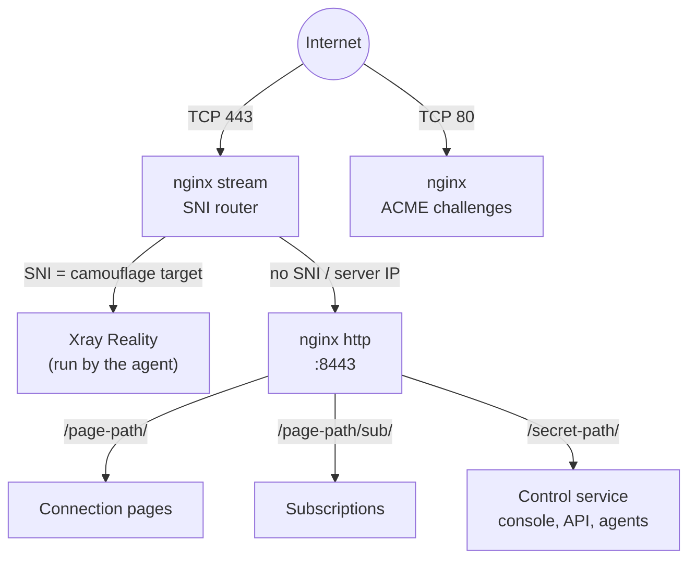
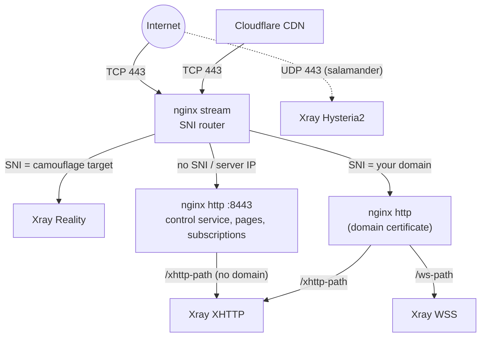
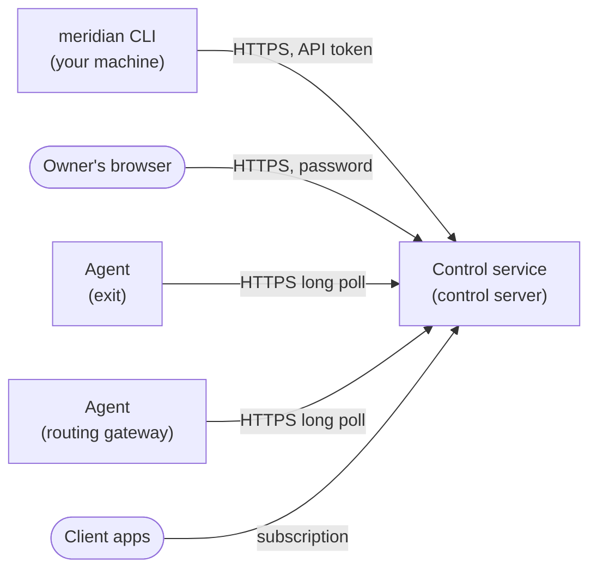

## پشته فناوری

- **VLESS+Reality** (Xray-core) — پروتکل اساسی. خود را به‌عنوان وب‌سایت TLS واقعی جا می‌زند: هر کسی که سرور را probe می‌کند گواهینامه واقعی آن سایت را می‌بیند (ترجیحاً سایتی که کنار سرور شما میزبانی می‌شود). فقط کلاینت‌هایی با کلید صحیح به proxy دسترسی دارند.
- **XHTTP** (Xray-core) — یک مسیر TLS روی دامنه شما، یا وقتی دامنه ندارید، روی IP سرور با گواهینامه IP از Let's Encrypt.
- **WSS** (Xray-core) — یک مسیر TLS روی دامنه خودتان که در حالت domain اضافه می‌شود. وقتی Cloudflare دامنه را proxy می‌کند، این مسیر و XHTTP از CDN عبور می‌کنند و از IP block جان سالم به‌در می‌برند.
- **Hysteria2** (Xray-core) — آخرین راه‌حل روی UDP/443 برای شبکه‌های lossy که در obfuscation salamander پیچیده شده تا شبیه QUIC نباشد. به‌طور پیش‌فرض روشن است (`--no-hysteria2` آن را خاموش می‌کند).
- **سرویس کنترل** — سرویس خود Meridian (`meridian serve`) روی سرور کنترل. کاربران، ترافیک، revisionها و پشتیبان‌ها را در یک فایل SQLite نگه می‌دارد، اشتراک را در همهٔ قالب‌ها ارائه می‌کند و کنسول وب مالک را میزبانی می‌کند. به‌صورت یک واحد systemd اجرا می‌شود، بدون Docker و بدون سرور پایگاه داده.
- **agent گره** — یک برنامهٔ کوچک و ایستای Rust روی هر exit و هر routing gateway. خودش از طریق HTTPS روی پورت 443 به سرویس کنترل وصل می‌شود، امضای سندی را که دریافت می‌کند بررسی می‌کند و Xray را به‌صورت سرویسی جداگانه اجرا می‌کند. گره‌ها هیچ پورت مدیریتی باز نمی‌کنند.
- **nginx** — TCP/443 عمومی را در اختیار دارد. ماژول stream بدون خاتمه TLS اتصالات را بر اساس SNI مسیریابی می‌کند؛ ماژول http برای سرویس کنترل، صفحات اتصال، اشتراک و مسیرهای domain TLS را خاتمه می‌دهد. گواهینامه‌ها از Let's Encrypt از طریق [acme.sh](https://github.com/acmesh-official/acme.sh) می‌آیند.
- **Realm** — TCP forwarder روی سرورهای relay.
- **uTLS** — اتصالات کلاینت Client Hello TLS یک مرورگر را کپی می‌کنند (Chrome، با نسخه‌های Firefox به‌عنوان ورودی‌های پشتیبان)، بنابراین مثل ترافیک معمولی مرورگر به نظر می‌رسند.

## توپولوژی سرویس

### سرور تنها (`meridian deploy IP`)

nginx stream TLS را خاتمه **نمی‌دهد**. SNI را از Client Hello می‌خواند و جریان TCP خام را forward می‌کند. سرویس کنترل، صفحات اتصال و اشتراک با گواهینامه Let's Encrypt برای IP سرور (کوتاه‌مدت، تجدید خودکار) ارائه می‌شوند.

پیوندهای به‌اشتراک‌گذاری شده زیر مسیر صفحهٔ اتصال قرار دارند: صفحات در `/<page-path>/<id>/`، اشتراک در `/<page-path>/sub/<id>`. کنسول، API و نقطهٔ اتصال agentها روی مسیر مخفی جداگانه قرار دارند که پیوندهای به‌اشتراک‌گذاری شده هیچ‌گاه آن را افشا نمی‌کنند.

### حالت Domain

دامنه فقط مسیرهای proxy را حمل می‌کند؛ سرویس کنترل و صفحات روی گواهینامه IP می‌مانند.

### Relays

relay ترافیک TCP خام را از IP داخلی به شنوندهٔ Reality روی سرور خروجی منتقل می‌کند. رمزنگاری سرتاسری بین کلاینت و خروجی برقرار است و relay هرگز متن آشکار را نمی‌بیند. سرورهای relay فقط Reality را حمل می‌کنند. `meridian setup` همچنین می‌تواند زنجیره‌های relay چندگامی و دروازه‌های مسیریابی بسازد که سرور خروجی (یا مجموعه‌ای از خروجی‌ها با بررسی سلامت) را بر اساس قانون انتخاب می‌کنند یا ترافیک منطبق را مستقیم از خود دروازه بیرون می‌فرستند.

### سرویس کنترل و agentها

همهٔ اتصال‌ها به سمت سرویس کنترل است؛ هیچ چیزی به یک گره وصل نمی‌شود. هر agent خودش از طریق HTTPS روی 443 وصل می‌شود، منتظر سند جدید می‌ماند و گزارش می‌دهد چه چیزی را اعمال کرده و چه مقدار ترافیک شمرده است. سرویس کنترل هر سند گره را با کلید خود ناوگان امضا می‌کند و agent سندی را که امضایش تأیید نشود رد می‌کند، پس سند جعلی یا تکراری هیچ چیزی را تغییر نمی‌دهد. گرهٔ جدید با یک توکن ثبت یک‌بارمصرف که Meridian از طریق SSH به آن می‌دهد عضو می‌شود و سپس گواهینامه‌ای از مرجع صدور گواهی خود ناوگان دریافت می‌کند.

ترافیک در هر گزارش فقط یک بار شمرده می‌شود، حتی اگر گزارش دوباره ارسال شود. سرویس فقط مجموع ترافیک هر نفر را نگه می‌دارد و هرگز ثبت نمی‌کند که چه کسی از کجا وصل می‌شود.

## نحوه کار Reality
1. هر exit یک **x25519 keypair** دارد. کلاینت‌ها کلید عمومی را دریافت می‌کنند؛ کلید خصوصی روی سرور می‌ماند.
2. کلاینت روی پورت 443 با TLS Client Hello که نام هدف camouflage را شامل است (به مثال `www.google.com`) اتصال برقرار می‌کند.
3. برای ناظر، این اتصال عادی HTTPS به آن سایت است.
4. **prober** بدون کلید از طریق به سایت واقعی عبور می‌کند و گواهینامه معتبر آن را می‌بیند.
5. کلاینت با احراز هویت معتبر تونل VLESS را دریافت می‌کند.
6. **uTLS** Client Hello را مطابق Chrome می‌سازد، TLS fingerprinting را شکست می‌دهد.

## مدل State

- **Topology** — `~/.config/meridian/cluster.yml` روی ماشین شما توپولوژی بازبینی‌شده (سرور کنترل، خروجی‌ها، relayها، دروازه‌ها، مسیرهای پروتکل و فهرست کاربران)، نشانی و توکن API سرویس کنترل و کلیدهایی را که Meridian تولید کرده نگهداری می‌کند. `meridian setup`، `deploy`، `client add`، `node add` و `relay add` آن را تغییر می‌دهند؛ دستی ویرایش نکنید.
- **Clients** — حساب‌ها، کلیدها، وضعیت، محدودیت‌ها و ترافیک در پایگاه دادهٔ سرویس کنترل روی سرور کنترل نگهداری می‌شوند.
- **Revisions** — سرویس کنترل هر apply بازبینی‌شده را ثبت می‌کند: چه کسی آن را انجام داد، طرح آن و اینکه اعمال شد یا نه. `meridian fleet history` آن‌ها را فهرست می‌کند.
- **Snapshots** — پس از هر تغییر، هر ماشینی که ناوگان را مدیریت می‌کند یک نسخهٔ رمزنگاری‌شده از وضعیت سرویس کنترل را در `snapshots/` ذخیره می‌کند که با کلید همان ماشین یا کلید بازیابی خوانده می‌شود. ببینید [بازیابی](/fa/recovery/#سرور-کنترل-از-دست-رفت).
- **Saved servers** — `~/.config/meridian/servers.json` جزئیات اتصال SSH را شامل می‌شود.

## Plan و apply

Meridian توپولوژی را به فهرستی از منابع تبدیل می‌کند: قوانین firewall، مسیرهای nginx، گواهینامه‌ها، سرویس‌های Realm، agentهای گره، سندی که هر گره اجرا می‌کند، نقاط اتصال کلاینت و کاربران. `meridian plan` هر یک را روی سرورهای فعال و سرویس کنترل بررسی می‌کند و گزارش می‌دهد چه چیزی نیاز به اصلاح دارد. `meridian apply` دقیقاً همان طرحی را که نشان داده اعمال می‌کند و در هر مرحله checkpoint ذخیره می‌کند تا در صورت قطع شدن، اجرای بعدی با اطمینان ادامه پیدا کند. منابعی که نتیجهٔ اعمال آن‌ها نامشخص باشد، پیش از تلاش مجدد دوباره بررسی می‌شوند. هر apply در طول اجرا یک lease در سرویس کنترل نگه می‌دارد، پس دو ماشین هرگز هم‌زمان apply نمی‌کنند و ماشینی که نسخهٔ عقب‌مانده دارد تا به‌روز نشود apply را رد می‌کند.

هر چیزی در topology را می‌توان اضافه و حذف کرد: کاربران، مسیرهای پروتکل، exitها، relayها و routing gatewayها. بعد از اینکه نقشه جدید همگرا شود، apply آن‌هایی را که آن را ترک کرده‌اند حذف می‌کند (کاربران، نقاط اتصال کلاینت، agentهای گره و Xray آن‌ها، فایل‌های nginx، سرویس‌های Realm، گواهینامه‌ها، قوانین firewall). سرور کنترل استثنا است: نشانی آن بخشی از هر URL اشتراک است، بنابراین فقط با `meridian teardown` حذف می‌شود یا با `meridian restore` جابه‌جا می‌شود.

وضعیت، محدودیت‌ها و تاریخ انقضای کلاینت‌ها مال شماست، از CLI یا کنسول؛ apply هرگز آن‌ها را تغییر نمی‌دهد.

## اختصاص Port

| Port | Service | Scope |
|------|---------|-------|
| 443/TCP | nginx stream (SNI router) | Public |
| 443/UDP | Xray Hysteria2 (on by default) | Public |
| 80/TCP | nginx (ACME challenges) | Public |
| 8443 | nginx http (control service, pages, subscriptions) | Internal |
| 8444 | nginx http, PROXY-protocol listener | Internal |
| 3000 | Control service (console, API, agents, subscriptions) | localhost |
| 10000+ | Xray Reality (per-exit) | host network, firewalled |
| 20000+ | Xray WSS (domain mode, per-exit) | host network, firewalled |
| 30000+ | Xray XHTTP (per-exit) | host network, firewalled |

Backend Xray ports از طریق nginx قابل دسترسی است؛ UFW آن‌ها را از اینترنت block می‌کند. agentها فقط خودشان وصل می‌شوند، پس هیچ گره‌ای پورت مدیریتی باز نمی‌کند. سرورهای Relay فقط SSH و پورت شنوندگی خود را باز می‌کنند.

## سرویس‌ها

نام واحدها و دایرکتوری‌ها خنثی است؛ پس میزبانی که `systemctl` یا `/opt` را نگاه می‌کند چیزی نمی‌بیند که نام نرم‌افزار proxy را بدهد. `meridian check` و `meridian doctor` نقش پشت هر نام را نشان می‌دهند. سرورها به Docker نیازی ندارند.

**روی سرور کنترل:**
- `ctld` — سرویس کنترل، یعنی `meridian serve` از نصب pin‌شده در `/opt/ctld`، روی `127.0.0.1:3000` پشت nginx

**روی هر exit و routing gateway** (و سرور کنترل، وقتی خودش هم exit است):
- `netagent` — agent گره
- `netcore` — Xray که agent آن را اجرا و پیکربندی می‌کند

**روی هر relay:**
- `netfwd-*` — یک سرویس Realm برای هر گام relay

agent یک برنامهٔ ایستا برای سرورهای x86-64 و ARM64 است. وقتی نسخهٔ جدید build تازه‌ای می‌آورد، Meridian آن را در جا ارتقا می‌دهد و هویت گره را حفظ می‌کند.

## Teardown

`meridian teardown IP` سرویس کنترل، agent و Xray، فایل‌های nginx Meridian، گواهینامه‌ها، سرویس‌های Realm و قوانین firewall را حذف می‌کند (بعلاوه 3x-ui از Meridian 3.x). package‌های سیستم می‌مانند. روی deployment تک‌سرور، `cluster.yml` محلی را نیز حذف می‌کند. در ناوگان چندسرور، سرورهایی را که هنوز نقش دارند رد می‌کند.

## محل فایل‌ها

### روی سرور کنترل
- `/opt/ctld/` — نصب pin‌شدهٔ سرویس کنترل
- `/etc/ctld/config.json` — پیکربندی آن
- `/var/lib/ctld/` — پایگاه دادهٔ آن (کاربران، ترافیک، revisionها، کلیدهای پشتیبان)
- `/etc/nginx/stream.d/meridian-v4-*.conf` — SNI routing
- `/etc/nginx/sites-available/meridian-v4-*.conf` — سایت‌های TLS و reverse proxy
- `/etc/ssl/meridian/` — گواهینامه‌ها

### روی هر exit و routing gateway
- `/usr/local/bin/netagent` — agent
- `/etc/netagent/` — اطلاعات ثبت آن و پیکربندی Xray که می‌نویسد
- `/var/lib/netagent/` — کلیدها، گواهینامه و وضعیت آن
- `/usr/local/lib/netagent/` — Xray

### روی هر relay
- `/etc/netfwd/` — پیکربندی Realm، اجرا شده از `/usr/local/bin/netfwd` توسط سرویس‌های systemd `netfwd-*`. میزبان‌های relay هیچ واحد مریدیان‌نام‌شده، مسیر یا نظر firewall (`fw-*`) ندارند.

### روی ماشین شما### روی ماشین شما
- `~/.config/meridian/cluster.yml` — topology، دسترسی سرویس کنترل، کلیدها
- `~/.config/meridian/cluster.yml.bak` — backup گرفته‌شده پیش از عملیات تخریبی
- `~/.config/meridian/servers.json` — سرورهای SSH ذخیره شده
- `~/.config/meridian/setup.json` — پیشرفت `meridian setup` (بدون اسرار)
- `~/.config/meridian/snapshots/` — snapshotهای رمزنگاری‌شدهٔ سرویس کنترل
- `~/.config/meridian/device.key` — کلید این ماشین برای آن snapshotها
- `~/.config/meridian/ssh/meridian_ed25519` — کلید SSH مدیریت‌شده، وقتی تولید شود
- `~/.config/meridian/cache/` — update-check cache

این دایرکتوری در صورت تنظیم بودن `$XDG_CONFIG_HOME` از آن پیروی می‌کند و `MERIDIAN_HOME` آن را بازنویسی می‌کند. تا زمانی که `~/.config/meridian/` وجود ندارد، Meridian اگر `~/.meridian-v4/` یا `~/.meridian/` یک fleet داشته باشد (فایل `servers.json` دارد) از آن‌ها هم استفاده می‌کند. وضعیت Meridian 3.x در `~/.meridian/` هرگز دست نمی‌خورد.

چند ناوگان می‌توانند به‌صورت زمینه (`meridian context`) روی یک دستگاه باشند. این دایرکتوری زمینهٔ `default` است؛ هر زمینهٔ دیگر `cluster.yml`، نسخهٔ پشتیبان آن، `servers.json`، `setup.json`، snapshotها و کلید دستگاه خودش را در `contexts/NAME/` نگه می‌دارد، و کلید SSH، کش بررسی به‌روزرسانی، انتخاب زبان و Xray محلی مشترک می‌مانند. انتخاب با `--context`، سپس `MERIDIAN_CONTEXT`، سپس `current-context` ذخیره‌شده است؛ `MERIDIAN_HOME` یک ناوگان را ثابت می‌کند.
