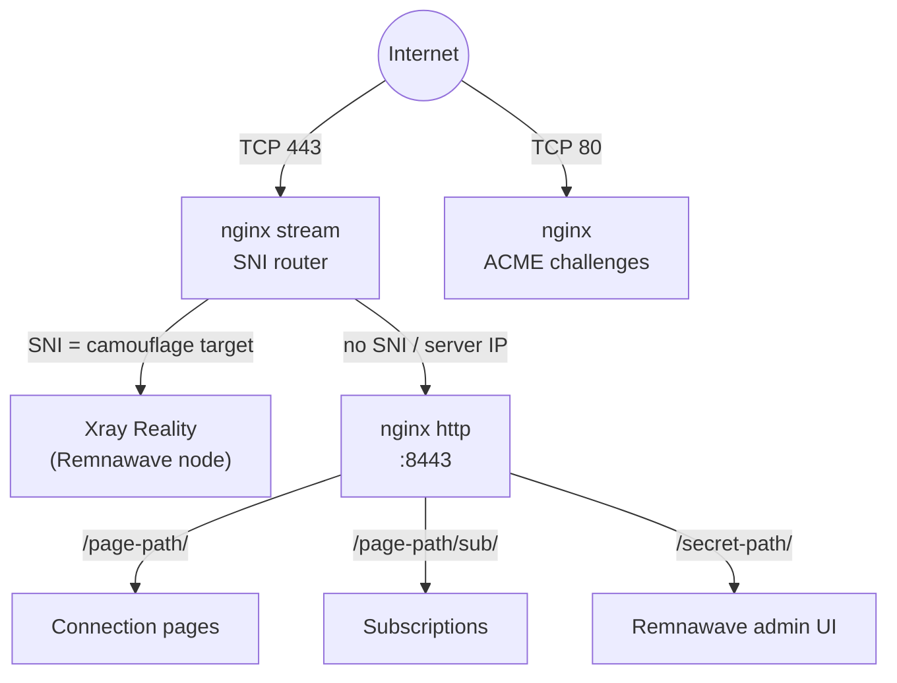
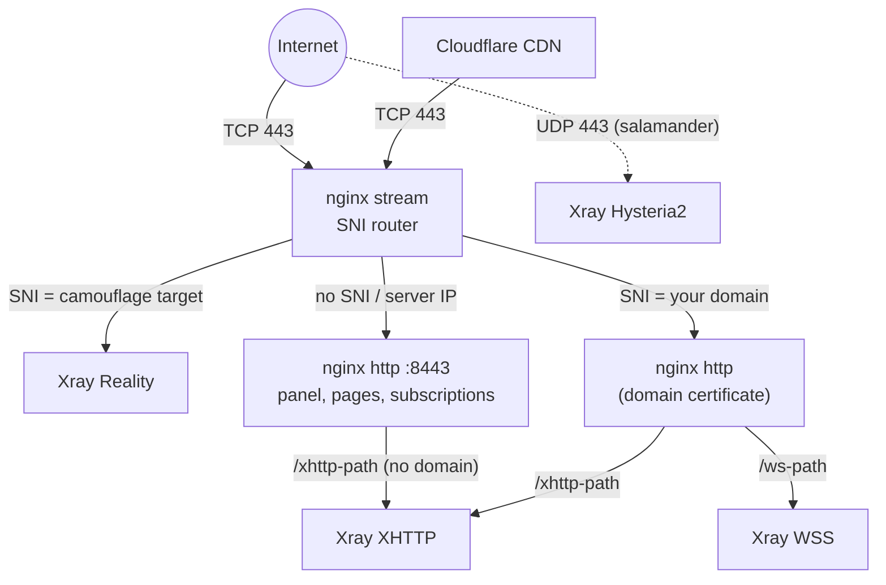
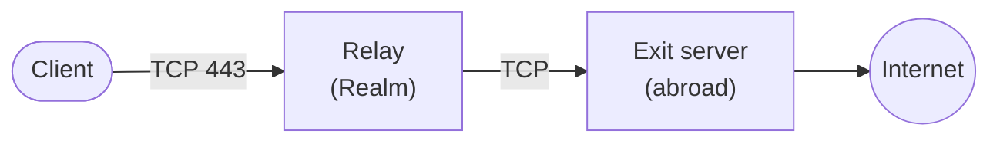

## پشته فناوری

- **VLESS+Reality** (Xray-core) — پروتکل اساسی. خود را به‌عنوان وب‌سایت TLS واقعی جا می‌زند: هر کسی که سرور را probe می‌کند گواهینامه واقعی آن سایت را می‌بیند (ترجیحاً سایتی که کنار سرور شما میزبانی می‌شود). فقط کلاینت‌هایی با کلید صحیح به proxy دسترسی دارند.
- **XHTTP** (Xray-core) — یک مسیر TLS روی دامنه شما، یا وقتی دامنه ندارید، روی IP سرور با گواهینامه IP از Let's Encrypt.
- **WSS** (Xray-core) — یک مسیر TLS روی دامنه خودتان که در حالت domain اضافه می‌شود. وقتی Cloudflare دامنه را proxy می‌کند، این مسیر و XHTTP از CDN عبور می‌کنند و از IP block جان سالم به‌در می‌برند.
- **Hysteria2** (Xray-core) — آخرین راه‌حل روی UDP/443 برای شبکه‌های lossy که در obfuscation salamander پیچیده شده تا شبیه QUIC نباشد. به‌طور پیش‌فرض روشن است (`--no-hysteria2` آن را خاموش می‌کند).
- **Remnawave** — پشتهٔ پنل: `remnawave/backend` (API و رابط مدیر، با PostgreSQL و Valkey) روی سرور کنترل، `remnawave/node` (Xray را اجرا می‌کند) روی هر exit، و `remnawave/subscription-page`. Meridian نسخه‌های تست‌شده را pin می‌کند و با پنل از طریق REST API صحبت می‌کند.
- **nginx** — TCP/443 عمومی را در اختیار دارد. ماژول stream بدون خاتمه TLS اتصالات را بر اساس SNI مسیریابی می‌کند؛ ماژول http برای پنل، صفحات اتصال، اشتراک و مسیرهای domain TLS را خاتمه می‌دهد. گواهینامه‌ها از Let's Encrypt از طریق [acme.sh](https://github.com/acmesh-official/acme.sh) می‌آیند.
- **Realm** — TCP forwarder روی سرورهای relay.
- **uTLS** — اتصالات کلاینت Client Hello TLS یک مرورگر را کپی می‌کنند (Chrome، با نسخه‌های Firefox به‌عنوان ورودی‌های پشتیبان)، بنابراین مثل ترافیک معمولی مرورگر به نظر می‌رسند.

## توپولوژی سرویس

### سرور تنها (`meridian deploy IP`)

nginx stream TLS را خاتمه **نمی‌دهد**. SNI را از Client Hello می‌خواند و جریان TCP خام را forward می‌کند. پنل، صفحات اتصال و اشتراک با گواهینامه Let's Encrypt برای IP سرور (کوتاه‌مدت، تجدید خودکار) ارائه می‌شوند.

پیوندهای به‌اشتراک‌گذاری شده زیر مسیر صفحهٔ اتصال قرار دارند: صفحات در `/<page-path>/<id>/`، اشتراک در `/<page-path>/sub/<id>`. پنل مدیریت روی مسیر مخفی جداگانه قرار دارد که پیوندهای به‌اشتراک‌گذاری شده هیچ‌گاه آن را افشا نمی‌کنند.

### حالت Domain

دامنه فقط مسیرهای proxy را حمل می‌کند؛ پنل و صفحات روی گواهینامه IP می‌مانند.

### Relays

relay ترافیک TCP خام را از IP داخلی به شنوندهٔ Reality روی سرور خروجی منتقل می‌کند. رمزنگاری سرتاسری بین کلاینت و خروجی برقرار است و relay هرگز متن آشکار را نمی‌بیند. سرورهای relay فقط Reality را حمل می‌کنند. `meridian setup` همچنین می‌تواند زنجیره‌های relay چندگامی و دروازه‌های مسیریابی بسازد که سرور خروجی (یا مجموعه‌ای از خروجی‌ها با بررسی سلامت) را بر اساس قانون انتخاب می‌کنند یا ترافیک منطبق را مستقیم از خود دروازه بیرون می‌فرستند.

## نحوه کار Reality

1. هر exit یک **x25519 keypair** دارد. کلاینت‌ها کلید عمومی را دریافت می‌کنند؛ کلید خصوصی روی سرور می‌ماند.
2. کلاینت روی پورت 443 با TLS Client Hello که نام هدف camouflage را شامل است (به مثال `www.google.com`) اتصال برقرار می‌کند.
3. برای ناظر، این اتصال عادی HTTPS به آن سایت است.
4. **prober** بدون کلید از طریق به سایت واقعی عبور می‌کند و گواهینامه معتبر آن را می‌بیند.
5. کلاینت با احراز هویت معتبر تونل VLESS را دریافت می‌کند.
6. **uTLS** Client Hello را مطابق Chrome می‌سازد، TLS fingerprinting را شکست می‌دهد.

## مدل State

- **Topology** — `~/.config/meridian/cluster.yml` روی ماشین شما توپولوژی بازبینی‌شده (سرور کنترل، خروجی‌ها، relayها، دروازه‌ها، مسیرهای پروتکل و فهرست کاربران)، دسترسی پنل و کلیدهایی را که Meridian تولید کرده نگهداری می‌کند. `meridian setup`، `deploy`، `client add`، `node add` و `relay add` آن را تغییر می‌دهند؛ دستی ویرایش نکنید.
- **Clients** — حساب‌ها، کلیدها، وضعیت و ترافیک در دیتابیس Remnawave روی سرور کنترل نگهداری می‌شوند.
- **Saved servers** — `~/.config/meridian/servers.json` جزئیات اتصال SSH را شامل می‌شود.

## Plan و apply

Meridian توپولوژی را به فهرستی از منابع تبدیل می‌کند: قوانین firewall، مسیرهای nginx، کانتینرها، پروفایل‌های Remnawave، میزبان‌ها، کاربران و قالب‌ها. `meridian plan` هر یک را روی سرورهای فعال و پنل بررسی می‌کند و گزارش می‌دهد چه چیزی نیاز به اصلاح دارد. `meridian apply` دقیقاً همان طرحی را که نشان داده اعمال می‌کند و در هر مرحله checkpoint ذخیره می‌کند تا در صورت قطع شدن، اجرای بعدی با اطمینان ادامه پیدا کند. منابعی که نتیجهٔ اعمال آن‌ها نامشخص باشد، پیش از تلاش مجدد دوباره بررسی می‌شوند.

هر چیزی در topology را می‌توان اضافه و حذف کرد: کاربران، مسیرهای پروتکل، exitها، relayها و routing gatewayها. بعد از اینکه نقشه جدید همگرا شود، apply آن‌هایی را که آن را ترک کرده‌اند حذف می‌کند (کاربران، میزبان‌ها و node‌های پنل، فایل‌های nginx، سرویس‌های Realm، گواهینامه‌ها، قوانین firewall). سرور کنترل استثنا است: نشانی آن بخشی از هر URL اشتراک است، بنابراین فقط با `meridian teardown` حذف می‌شود.

ویرایش‌های پنل برای منابعی که Meridian مالک است در `meridian plan` نشان می‌دهند و توسط apply بعدی بازگردانده می‌شوند. تنظیمات Remnawave که Meridian مدیریت نمی‌کند تنهایشان می‌مانند.

## اختصاص Port

| Port | Service | Scope |
|------|---------|-------|
| 443/TCP | nginx stream (SNI router) | Public |
| 443/UDP | Xray Hysteria2 (on by default) | Public |
| 80/TCP | nginx (ACME challenges) | Public |
| 8443 | nginx http (panel, pages, subscriptions) | Internal |
| 8444 | nginx http, PROXY-protocol listener (used with `--client-ips`) | Internal |
| 3000 | Remnawave backend (admin UI + API) | localhost |
| 3010 | Remnawave node API | host network |
| 3020 | Remnawave subscription page | localhost |
| 10000+ | Xray Reality (per-exit) | host network, firewalled |
| 20000+ | Xray WSS (domain mode, per-exit) | host network, firewalled |
| 30000+ | Xray XHTTP (per-exit) | host network, firewalled |

Backend Xray ports از طریق nginx قابل دسترسی است؛ UFW آن‌ها را از اینترنت block می‌کند. سرورهای Relay فقط SSH و پورت شنوندگی خود را باز می‌کنند.

## Docker containers

نام containerها و دایرکتوری‌ها خنثی است؛ پس میزبانی که `docker ps` یا `/opt` را نگاه می‌کند چیزی نمی‌بیند که نام نرم‌افزار proxy را بدهد (images همان tagهای upstream خود را نگه می‌دارند). `meridian check` و `meridian doctor` نقش پشت هر نام را نشان می‌دهند.

**روی سرور کنترل:**
- `ctlsvc-api` — backend API و admin UI مربوط به Remnawave روی `127.0.0.1:3000`
- `ctlsvc-db` — PostgreSQL (users, hosts, profiles)
- `ctlsvc-cache` — Valkey cache
- `ctlsvc-web` — subscription frontend مربوط به Remnawave روی `127.0.0.1:3020`
- `netagent` — node مربوط به Remnawave (Xray)، در host networking با `NET_ADMIN`

**روی هر exit دیگر:**
- `netagent` تنها، از طریق secret per-node با پنل ثبت شده

سرورهایی که توسط نسخه beta 4.0 deploy شده‌اند این‌ها را با نام `remnawave*` از `/opt/remnawave` و `/opt/remnanode` اجرا می‌کردند. `meridian apply` بعدی آن‌ها را stop می‌کند، دایرکتوری پنل (یعنی `data/` مربوط به PostgreSQL و secretهای `.env`) را با یک rename به `/opt/ctlsvc` منتقل می‌کند و containerهای تغییرنام‌یافته را start می‌کند. Users، لینک‌های client و API tokenها بدون تغییر می‌مانند.

## Teardown

`meridian teardown IP` پنل و node containers و volumes، فایل‌های nginx Meridian، گواهینامه‌ها، سرویس‌های Realm و قوانین firewall را حذف می‌کند (بعلاوه 3x-ui از Meridian 3.x). Docker و package‌های سیستم می‌مانند. روی deployment تنهای سرور محلی `cluster.yml` را نیز حذف می‌کند. در fleet چند‌سرور دستورات سرورهایی که هنوز نقش دارند را رد می‌کند.

## محل فایل‌ها

### روی سرور کنترل
- `/opt/ctlsvc/` — فایل compose پنل، `.env` و `data/` مربوط به PostgreSQL
- `/etc/nginx/stream.d/meridian-v4-*.conf` — SNI routing
- `/etc/nginx/sites-available/meridian-v4-*.conf` — سایت‌های TLS و reverse proxy
- `/etc/ssl/meridian/` — گواهینامه‌ها

### روی هر exit
- `/opt/netagent/` — فایل compose node و `.env`

### روی هر relay
- `/etc/netfwd/` — پیکربندی Realm، اجرا شده از `/usr/local/bin/netfwd` توسط سرویس‌های systemd `netfwd-*`. میزبان‌های relay هیچ واحد مریدیان‌نام‌شده، مسیر یا نظر firewall (`fw-*`) ندارند.

### روی ماشین شما
- `~/.config/meridian/cluster.yml` — topology، دسترسی پنل، کلیدها
- `~/.config/meridian/cluster.yml.bak` — backup گرفته‌شده پیش از عملیات تخریبی
- `~/.config/meridian/servers.json` — سرورهای SSH ذخیره شده
- `~/.config/meridian/setup.json` — پیشرفت `meridian setup` (بدون اسرار)
- `~/.config/meridian/ssh/meridian_ed25519` — کلید SSH مدیریت‌شده، وقتی تولید شود
- `~/.config/meridian/cache/` — update-check cache

این دایرکتوری در صورت تنظیم بودن `$XDG_CONFIG_HOME` از آن پیروی می‌کند و `MERIDIAN_HOME` آن را بازنویسی می‌کند. تا زمانی که `~/.config/meridian/` وجود ندارد، Meridian اگر `~/.meridian-v4/` یا `~/.meridian/` یک fleet داشته باشد (فایل `servers.json` دارد) از آن‌ها هم استفاده می‌کند. وضعیت Meridian 3.x در `~/.meridian/` هرگز دست نمی‌خورد.
