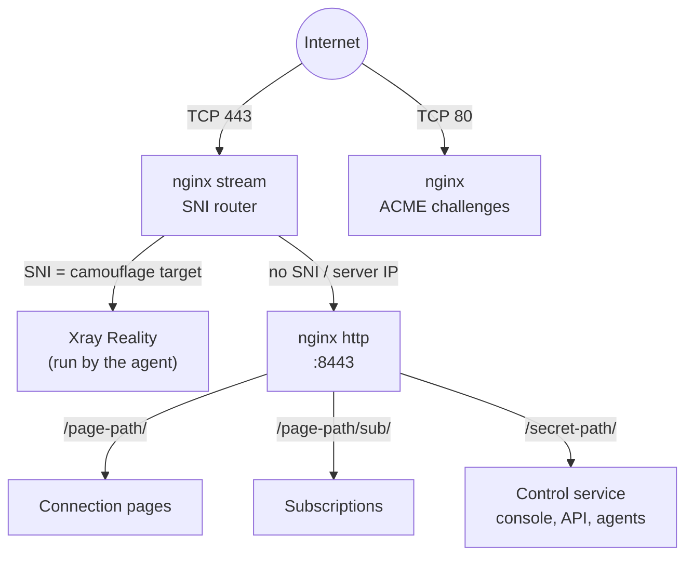
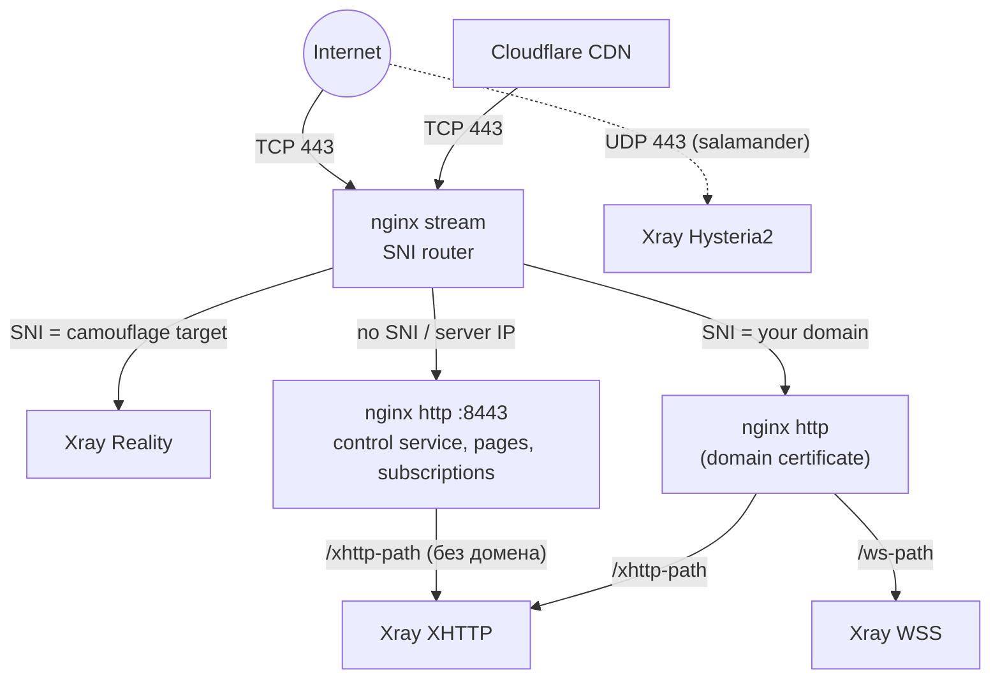
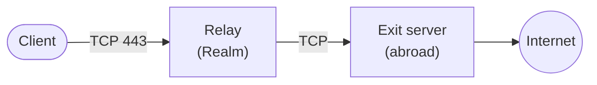

## Стек технологий

- **VLESS+Reality** (Xray-core) — основной протокол. Маскирует сервер под настоящий сайт с TLS 1.3: любая внешняя проверка без ключа видит подлинный сертификат выбранного сайта (предпочтительно сайта из той же сети, где размещён ваш сервер), а VPN-туннель открывается только для клиентов с вашим ключом.
- **XHTTP** (Xray-core) — транспорт поверх HTTPS, работающий либо на вашем домене, либо напрямую по IP-адресу сервера с краткосрочным IP-сертификатом Let's Encrypt.
- **WSS** (Xray-core) — транспорт VLESS поверх WebSocket и TLS, добавляемый в режиме домена. При включённом проксировании домена в Cloudflare оба маршрута (XHTTP и WSS) идут через CDN и продолжают работать даже при блокировке IP-адреса сервера.
- **Hysteria2** (Xray-core) — резервный протокол поверх UDP/443 для медленных сетей и каналов с потерей пакетов, защищённый обфускацией salamander (включён по умолчанию; отключается флагом `--no-hysteria2`).
- **Сервис управления и веб-панель** — встроенная служба Meridian (`meridian serve`, работает как `ctld`) на сервере управления. Хранит базу пользователей, статистику трафика, историю ревизий, настройки конфиденциальности и ключи резервного копирования в одном файле SQLite, формирует подписки во всех форматах и страницы подключения, а также обслуживает встроенную веб-панель (консоль владельца). Работает как обычная служба systemd — без Docker и отдельных СУБД.
- **Агент узла** — компактный статический бинарный файл на Rust, работающий на каждом выходном сервере и шлюзе маршрутизации. Агент сам устанавливает исходящее HTTPS-соединение с сервисом управления на порту 443, проверяет криптографическую подпись полученного документа и запускает Xray отдельной системной службой. Открывать входящие порты управления на узлах не требуется.
- **nginx** — принимает все входящие соединения на порту TCP/443. Модуль `stream` разбирает поле SNI в TLS Client Hello без расшифровки трафика и распределяет потоки, а модуль `http` терминирует TLS для сервиса управления, страниц подключения, подписок и доменных маршрутов. Сертификаты Let's Encrypt выпускаются и продлеваются через [acme.sh](https://github.com/acmesh-official/acme.sh).
- **Realm** — легковесный TCP-форвардер на промежуточных серверах.
- **uTLS** — библиотека имитации браузерного отпечатка TLS Client Hello на стороне клиентских приложений (основной профиль использует отпечаток Chrome, а запасные копии — Firefox).

## Топология сервисов

### Одиночный сервер (`meridian deploy IP`)

Публичные маршруты на схеме обслуживаются процессом `ctld`: корень пути страниц подключения перенаправляет старые ссылки формата UUID, а префикс `/sub/` отдаёт веб-страницы браузерам, профили конфигурации — клиентским приложениям и общие ресурсы PWA.

Модуль `nginx stream` **не** расшифровывает TLS: он лишь считывает имя хоста (SNI) из начального пакета Client Hello и перенаправляет TCP-поток нужному обработчику. Сервис управления, страницы подключения и подписки работают по HTTPS с краткосрочным сертификатом Let's Encrypt, выпущенным для IP-адреса сервера и автоматически продлеваемым по расписанию.

Каждая персональная ссылка имеет единый вид `/<page-path>/sub/<token>`: при открытии в браузере по ней отображается страница подключения, а при запросе из VPN-приложения возвращается профиль подписки. Веб-панель, административный API и точка подключения агентов расположены по отдельному секретному пути, который никогда не фигурирует в пользовательских ссылках.

Сервис управления динамически формирует страницу подключения, её `config.json` и веб-манифест на основе актуального списка пользователей, точек входа, настроек оформления и стран выходных серверов. Персональная страница доступна каждому пользователю, включая тех, кто был добавлен через веб-панель. Ответы для персональных страниц отдаются с заголовком `Cache-Control: no-store` и запретом индексации (`noindex`), а общие статические файлы PWA кэшируются по версии содержимого внутри `/<page-path>/sub/~pwa/`. Веб-сервер nginx отвечает за `Referrer-Policy` и сжатие ответов, а сервис управления выставляет для страницы политику `Content-Security-Policy` и другие защитные заголовки браузера. Старые ссылки вида `/<page-path>/<uuid>/` автоматически перенаправляются на актуальный адрес подписки, а применение обновлённой конфигурации удаляет устаревшие статические файлы страниц и старые service worker'ы.

### Режим домена

Ваш домен обслуживает только маршруты VPN (XHTTP и WSS), тогда как сервис управления, веб-панель и страницы подключения остаются на IP-сертификате.

### Промежуточные серверы

Промежуточный сервер принимает TCP-соединения на внутреннем IP-адресе и перенаправляет их на порт Reality выходного сервера. Шифрование остаётся сквозным между клиентом и выходным сервером, поэтому промежуточный сервер не имеет доступа к содержимому трафика. Через промежуточные серверы передаётся только Reality. С помощью мастера `meridian setup` можно также выстраивать цепочки из нескольких промежуточных серверов и добавлять шлюзы маршрутизации, распределяющие трафик между несколькими выходными серверами по правилам.

### Взаимодействие сервиса управления и агентов

Все управляющие соединения направлены к сервису управления — сам он никогда не подключается к узлам. Агент каждого узла устанавливает исходящее HTTPS-соединение с сервисом управления, ожидает новых конфигурационных документов (через long polling), применяет их и отправляет сводку о состоянии и счётчиках трафика. Каждый документ узла подписан закрытым ключом сервиса управления, поэтому агент отвергнет любой неподписанный или устаревший документ. Первичная привязка нового узла выполняется по одноразовому токену регистрации, который CLI передаёт по SSH, после чего агент получает клиентский сертификат от внутреннего удостоверяющего центра ваших серверов.

Прирост трафика учитывается ровно один раз для каждого отчёта, даже при повторной отправке пакета. По умолчанию сохраняются только общий объём трафика за всё время и время последней активности без IP-адресов клиентов; дополнительные режимы учёта устройств и посуточной истории описаны в разделе [Конфиденциальность](/ru/privacy/).

## Принцип работы Reality

1. На каждом выходном сервере генерируется **ключевая пара x25519**: открытый ключ передаётся клиентам в подписке, а закрытый остаётся на сервере.
2. Клиент подключается к порту 443 и отправляет стандартный пакет TLS Client Hello с именем выбранного сайта маскировки (например, `www.google.com`).
3. Для внешнего наблюдателя и систем DPI это выглядит как обычное HTTPS-соединение с указанным сайтом.
4. Любой **проверочный запрос (prober)** без вашего ключа прозрачно перенаправляется на настоящий сайт маскировки и получает его подлинный сертификат.
5. Клиент, прошедший криптографическую проверку ключа, получает туннель VLESS.
6. Библиотека **uTLS** формирует пакет Client Hello, в точности совпадающий с браузером Chrome (или Firefox в резервном профиле).

## Модель хранения состояния

- **Топология** — файл `~/.config/meridian/cluster.yml` на вашем компьютере хранит целевую топологию серверов (сервер управления, выходные и промежуточные серверы, шлюзы, протоколы и список объявленных клиентов), адрес и токен сервиса управления, а также сгенерированные ключи. Изменяйте её только командами `meridian setup`, `deploy`, `client add`, `node add` и `relay add` — не редактируйте `cluster.yml` вручную.
- **Учётные записи пользователей** — профили, ключи, статусы, лимиты и статистика трафика хранятся в базе SQLite сервиса управления на сервере управления.
- **История ревизий** — каждое применение плана записывается в сервисе управления с указанием автора, хеша плана и итогового статуса (просмотреть историю можно командой `meridian fleet history`).
- **Резервные снимки** — после каждого изменения каждый управляющий компьютер сохраняет в каталог `snapshots/` зашифрованный снимок состояния сервиса управления, который можно расшифровать ключом этого компьютера или ключом восстановления (см. [Сервер управления потерян](/ru/recovery/#сервер-управления-потерян)).
- **Реестр серверов** — параметры SSH-подключений хранятся в файле `~/.config/meridian/servers.json`.

## Планирование и применение (`plan` и `apply`)

Компилятор Meridian преобразует топологию в упорядоченный список ресурсов: правила файрвола, конфигурационные файлы nginx, TLS-сертификаты, службы Realm, агенты узлов, подписанные документы для узлов, клиентские точки входа и учётные записи пользователей. Команда `meridian plan` сверяет каждый ресурс с текущим состоянием серверов и сервиса управления и показывает расхождения. Команда `meridian apply` последовательно приводит ресурсы к целевому состоянию, сохраняя контрольные точки после каждого шага. На время выполнения `apply` в сервисе управления берётся временная блокировка (lease), исключающая одновременное применение с двух компьютеров.

Любые элементы топологии можно добавлять и удалять: после того как все актуальные ресурсы успешно применены, `apply` автоматически удаляет освободившиеся ресурсы (учётные записи, точки входа, службы и правила файрвола). Исключением является сам сервер управления: его адрес входит в ссылки подписок, поэтому удалить его можно только командой `meridian teardown`, а перенести на новый IP — командой `meridian restore`.

Статусы пользователей, лимиты трафика и сроки доступа, заданные через CLI или веб-панель, принадлежат сервису управления и никогда не сбрасываются при выполнении `apply`.

## Схема портов

| Порт | Служба | Доступность |
|------|---------|-------|
| 443/TCP | `nginx stream` (маршрутизация по SNI) | Публичный |
| 443/UDP | Xray Hysteria2 (включён по умолчанию) | Публичный |
| 80/TCP | `nginx` (HTTP-проверки ACME для выпуска сертификатов) | Публичный |
| 8443 | `nginx http` (сервис управления, страницы подключения, подписки) | Внутренний (`127.0.0.1`) |
| 8444 | `nginx http` (приём соединений с заголовком PROXY protocol) | Внутренний (`127.0.0.1`) |
| 3000 | Сервис управления (`ctld`: веб-панель, API, агенты, подписки) | `127.0.0.1` |
| 10000+ | Внутренние порты Xray Reality | Закрыты файрволом извне |
| 20000+ | Внутренние порты Xray WSS (в режиме домена) | Закрыты файрволом извне |
| 30000+ | Внутренние порты Xray XHTTP | Закрыты файрволом извне |

Внутренние порты Xray доступны только локально через nginx и закрыты из интернета правилами UFW. Агенты узлов работают только на исходящее подключение, а промежуточные серверы открывают только порт SSH и свой входной порт перенаправления.

## Системные службы

Названия юнитов systemd и рабочих каталогов на серверах выбраны нейтральными, чтобы в выводе `systemctl` или списке каталогов `/opt` не фигурировали названия VPN- и прокси-инструментов. Соответствие служб ролям отображается в выводе `meridian check` и `meridian doctor`.

**На сервере управления:**
- `ctld` — сервис управления (`meridian serve` из изолированного окружения в `/opt/ctld`), слушающий `127.0.0.1:3000` за nginx

**На каждом выходном сервере и шлюзе маршрутизации** (включая сервер управления, если он одновременно является выходным):
- `netagent` — агент узла
- `netcore` — процесс Xray, конфигурацией и запуском которого управляет агент

**На каждом промежуточном сервере:**
- `netfwd-*` — по одной службе Realm на каждое звено перенаправления

Бинарный файл агента скомпилирован статически (под архитектуры `x86_64` и `aarch64`) и обновляется на месте с сохранением ключей и удостоверения узла.

## Полное удаление (`teardown`)

Команда `meridian teardown IP` останавливает и удаляет сервис управления, агент узла и Xray, конфигурационные файлы nginx, сертификаты, службы Realm и правила файрвола, созданные Meridian (а также старую панель 3x-ui, если она осталась от версии 3.x). Базовые системные пакеты сохраняются. Если развёртывание состояло из одного сервера, одновременно очищается локальный файл `cluster.yml`. Если же в конфигурации несколько серверов, перед запуском `teardown` необходимо сначала снять с сервера роль командой `meridian node remove` или `meridian relay remove`.

## Расположение файлов

### На сервере управления
- `/opt/ctld/` — установленное окружение сервиса управления
- `/etc/ctld/config.json` — конфигурация сервиса управления
- `/var/lib/ctld/` — база данных SQLite (пользователи, трафик, ревизии, публичные ключи резервных копий)
- `/etc/nginx/stream.d/meridian-v4-*.conf` — правила маршрутизации SNI в `nginx stream`
- `/etc/nginx/sites-available/meridian-v4-*.conf` — конфигурация TLS и обратного прокси в `nginx http`
- `/etc/ssl/meridian/` — выпущенные TLS-сертификаты

### На каждом выходном сервере и шлюзе маршрутизации
- `/usr/local/bin/netagent` — бинарный файл агента узла
- `/etc/netagent/` — параметры привязки агента и сгенерированная конфигурация Xray
- `/var/lib/netagent/` — ключи, клиентский сертификат и применённое состояние узла
- `/usr/local/lib/netagent/` — бинарный файл и гео-базы Xray

### На каждом промежуточном сервере
- `/etc/netfwd/` — конфигурационные файлы Realm, запускаемые из `/usr/local/bin/netfwd` службами `netfwd-*` (без упоминаний Meridian или Realm в именах файлов и правилах файрвола `fw-*`)

### На вашем компьютере
- `~/.config/meridian/cluster.yml` — топология серверов, реквизиты доступа к сервису управления и ключи
- `~/.config/meridian/cluster.yml.bak` — резервная копия перед деструктивными операциями
- `~/.config/meridian/servers.json` — сохранённые профили SSH-серверов
- `~/.config/meridian/setup.json` — черновик пошагового мастера `meridian setup` (без секретов)
- `~/.config/meridian/snapshots/` — зашифрованные резервные снимки сервиса управления
- `~/.config/meridian/device.key` — закрытый ключ этого компьютера для расшифровки снимков
- `~/.config/meridian/ssh/meridian_ed25519` — автоматически созданный SSH-ключ Meridian
- `~/.config/meridian/cache/` — кэш проверки обновлений CLI

Расположение каталога учитывает переменную `$XDG_CONFIG_HOME`, а переменная `MERIDIAN_HOME` переопределяет его напрямую. Если каталог `~/.config/meridian/` ещё не существует, Meridian также проверяет `~/.meridian-v4/` и `~/.meridian/`, если в одном из них уже хранится конфигурация v4 (есть файл `servers.json`); файлы Meridian 3.x в `~/.meridian/` при этом никогда не затрагиваются.

Несколько независимых наборов серверов на одном компьютере разделяются по контекстам (`meridian context`). Корневой каталог настроек соответствует контексту `default`, а каждый дополнительный контекст хранит собственные `cluster.yml`, резервную копию, `servers.json`, `setup.json`, снимки `snapshots/` и `device.key` в подкаталоге `contexts/NAME/`, тогда как SSH-ключ, кэш проверки обновлений, выбранный язык и локальная сборка Xray остаются общими. Активный контекст определяется по приоритету: флаг `--context`, затем переменная `MERIDIAN_CONTEXT`, затем сохранённый `current-context`; переменная `MERIDIAN_HOME` жёстко фиксирует один каталог и отключает контексты.
