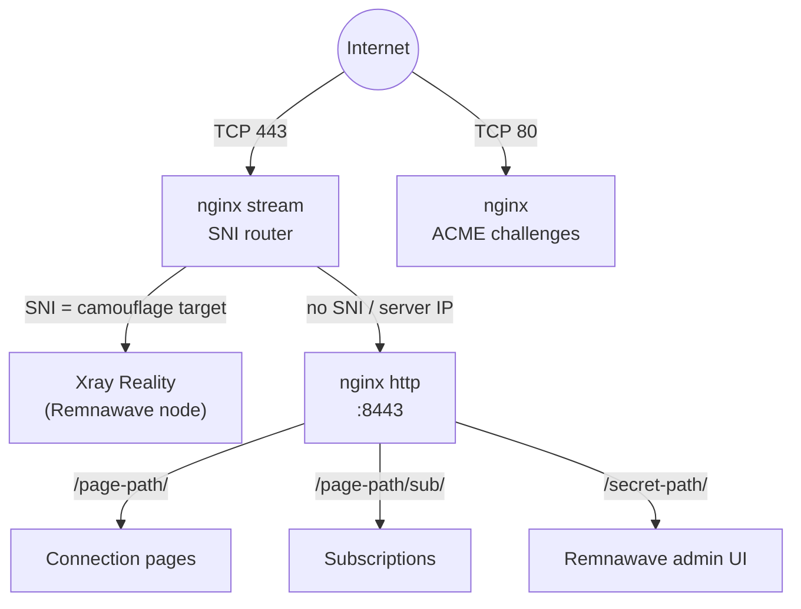
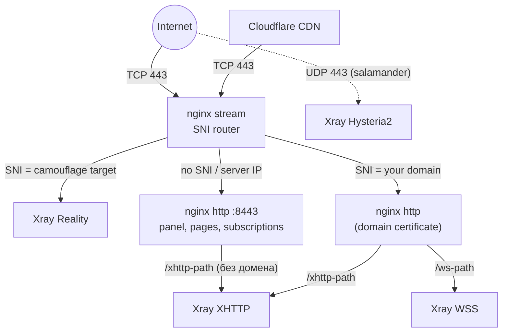
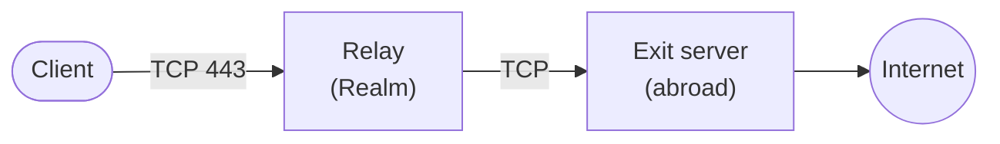

## Стек технологий

- **VLESS+Reality** (Xray-core) — основной протокол. Маскируется под реальный TLS-сайт: любой, кто проверяет сервер, видит подлинный сертификат этого сайта (лучше всего сайта, размещённого рядом с вашим сервером). Только клиенты с правильным ключом могут подключиться к прокси.
- **XHTTP** (Xray-core) — путь TLS на вашем домене или, если домена нет, на IP сервера с IP-сертификатом Let's Encrypt.
- **WSS** (Xray-core) — путь TLS на собственном домене, добавляется в режиме домена. Если домен проксируется через Cloudflare, он и XHTTP проходят через CDN и переживают блокировку IP.
- **Hysteria2** (Xray-core) — последний резервный путь UDP/443 для ненадёжных сетей, обёрнутый в обфускацию salamander, чтобы не выглядеть как QUIC. Включён по умолчанию (`--no-hysteria2` отключает).
- **Remnawave** — стек панели: `remnawave/backend` (API и админ-интерфейс, с PostgreSQL и Valkey) на сервере контроль-плана, `remnawave/node` (запускает Xray) на каждом выходе, и `remnawave/subscription-page`. Meridian фиксирует проверенные версии и общается с панелью через REST API.
- **nginx** — владеет публичным TCP/443. Его модуль stream маршрутизирует соединения по SNI без завершения TLS; его модуль http завершает TLS для панели, страниц подключения, подписок и путей домена. Сертификаты поступают от Let's Encrypt через [acme.sh](https://github.com/acmesh-official/acme.sh).
- **Realm** — TCP форвардер на серверах-ретрансляторах.
- **uTLS** — клиентские соединения копируют TLS Client Hello браузера (Chrome, а копии Firefox идут запасными записями), поэтому выглядят как обычный браузерный трафик.

## Топология сервисов

### Одиночный сервер (`meridian deploy IP`)

nginx stream **не** завершает TLS. Он читает SNI из Client Hello и пересылает необработанный TCP-поток. Панель, страницы подключения и подписки обслуживаются сертификатом Let's Encrypt для IP сервера (короткоживущий, автоматически обновляется).

Общие ссылки находятся под путём страницы подключения: страницы в `/<page-path>/<id>/`, подписки в `/<page-path>/sub/<id>`. Админ-панель находится на отдельном секретном пути, который общие ссылки никогда не раскрывают.

### Режим домена

Домен несёт только пути прокси; панель и страницы остаются на IP-сертификате.

### Ретрансляторы

Ретранслятор пересылает необработанный TCP с внутреннего IP на слушатель Reality выхода. Шифрование от конца к концу между клиентом и выходом; ретранслятор никогда не видит открытый текст. Ретрансляторы несут только Reality. `meridian setup` может также строить многоканальные цепи ретрансляторов и маршрутизирующие шлюзы, которые выбирают выход (или проверяемый пул выходов) по правилу.

## Как работает Reality

1. Каждый выход имеет **пару ключей x25519**. Клиенты получают открытый ключ; приватный ключ остаётся на сервере.
2. Клиент подключается на порту 443 с TLS Client Hello, называющим цель маскировки (например, `www.google.com`).
3. Для наблюдателя это выглядит как обычное HTTPS соединение с этим сайтом.
4. **Зондировщик** без ключа пропускается к реальному сайту и видит его подлинный сертификат.
5. Клиент с действительной аутентификацией получает туннель VLESS.
6. **uTLS** делает Client Hello совпадающим с Chrome, преодолевая TLS fingerprinting.

## Модель состояния

- **Топология** — `~/.config/meridian/cluster.yml` на вашей машине содержит рассмотренную топологию (контроль-план, выходы, ретрансляторы, шлюзы, пути протокола и список пользователей), доступ к панели и ключи, которые сгенерировал Meridian. `meridian setup`, `deploy`, `client add`, `node add` и `relay add` изменяют её; не редактируйте вручную.
- **Клиенты** — учётные записи, ключи, статус и трафик живут в базе Remnawave на сервере контроль-плана.
- **Сохранённые серверы** — `~/.config/meridian/servers.json` содержит детали подключения SSH.

## План и применение

Meridian преобразует топологию в список ресурсов: правила брандмауэра, маршруты nginx, контейнеры, профили Remnawave, хосты, пользователи и шаблоны. `meridian plan` наблюдает каждый на живых серверах и панели и сообщает, что нужно исправить. `meridian apply` применяет точный показанный план, контрольные точки на каждом шаге, чтобы прерванное применение возобновилось безопасно. Ресурсы, чей результат неопределён, переназначаются перед любым повтором.

В топологии можно добавлять и удалять что угодно: пользователей, пути протокола, выходы, ретрансляторы и маршрутизирующие шлюзы. После того как новый план сходится, apply удаляет то, что его покинуло (пользователей, хосты и узлы панели, файлы nginx, сервисы Realm, сертификаты, правила брандмауэра). Исключение — контрольный сервер: его адрес входит в каждый URL подписки, поэтому он уходит только через `meridian teardown`.

Правки панели ресурсам, которыми владеет Meridian, появляются в `meridian plan` и восстанавливаются следующим применением. Параметры Remnawave, которыми Meridian не управляет, оставляются как есть.

## Назначения портов

| Порт | Сервис | Область |
|------|--------|--------|
| 443/TCP | nginx stream (SNI маршрутизатор) | Публичный |
| 443/UDP | Xray Hysteria2 (включён по умолчанию) | Публичный |
| 80/TCP | nginx (ACME задачи) | Публичный |
| 8443 | nginx http (панель, страницы, подписки) | Внутренний |
| 8444 | nginx http, слушатель с протоколом PROXY (используется с `--client-ips`) | Внутренний |
| 3000 | Backend Remnawave (админ-интерфейс + API) | localhost |
| 3010 | API узла Remnawave | сеть хоста |
| 3020 | Страница подписки Remnawave | localhost |
| 10000+ | Xray Reality (на выход) | сеть хоста, firewalled |
| 20000+ | Xray WSS (режим домена, на выход) | сеть хоста, firewalled |
| 30000+ | Xray XHTTP (на выход) | сеть хоста, firewalled |

Backend-порты Xray достигаются через nginx; UFW блокирует их из интернета. Серверы-ретрансляторы открывают только SSH и их портслушания.

## Docker контейнеры

Имена контейнеров и каталогов нейтральны: хост, где смотрят `docker ps` или `/opt`, не увидит ничего, что называет прокси-ПО (образы сохраняют свои исходные теги). `meridian check` и `meridian doctor` показывают роль, стоящую за каждым именем.

**На сервере контроль-плана:**
- `ctlsvc-api` — backend API и админ-интерфейс Remnawave на `127.0.0.1:3000`
- `ctlsvc-db` — PostgreSQL (пользователи, хосты, профили)
- `ctlsvc-cache` — кэш Valkey
- `ctlsvc-web` — фронтенд подписки Remnawave на `127.0.0.1:3020`
- `netagent` — узел Remnawave (Xray), в сетевом хостинге с `NET_ADMIN`

**На каждом другом выходе:**
- `netagent` только, зарегистрирован у панели через секретный ключ узла

Серверы, развёрнутые бета-версией 4.0, запускали их как `remnawave*` из `/opt/remnawave` и `/opt/remnanode`. Следующий `meridian apply` останавливает их, одним переименованием переносит каталог панели (её `data/` PostgreSQL и секреты `.env`) в `/opt/ctlsvc` и запускает переименованные контейнеры. Пользователи, клиентские ссылки и API-токены остаются прежними.

## Демонтаж

`meridian teardown IP` удаляет контейнеры и тома панели и узла, файлы nginx Meridian, сертификаты, сервисы Realm и правила брандмауэра (плюс 3x-ui из Meridian 3.x). Docker и системные пакеты остаются. На одиночном серверном развёртывании удаляет также локальный `cluster.yml`. В многосерверном флоте отказывает серверам, которые всё ещё имеют роль.

## Расположения файлов

### На сервере контроль-плана
- `/opt/ctlsvc/` — файл compose панели, `.env` и `data/` PostgreSQL
- `/etc/nginx/stream.d/meridian-v4-*.conf` — SNI маршрутизация
- `/etc/nginx/sites-available/meridian-v4-*.conf` — TLS сайты и обратный прокси
- `/etc/ssl/meridian/` — сертификаты

### На каждом выходе
- `/opt/netagent/` — файл compose узла и `.env`

### На каждом ретрансляторе
- `/etc/netfwd/` — конфигурация Realm, запущена из `/usr/local/bin/netfwd` через сервисы `netfwd-*` systemd. На хостах ретрансляторов нет модулей с названиями Meridian, путей или комментариев брандмауэра (`fw-*`).

### На вашей машине
- `~/.config/meridian/cluster.yml` — топология, доступ к панели, ключи
- `~/.config/meridian/cluster.yml.bak` — резервная копия, сделанная перед деструктивными операциями
- `~/.config/meridian/servers.json` — сохранённые SSH серверы
- `~/.config/meridian/setup.json` — ход `meridian setup` (без секретов)
- `~/.config/meridian/ssh/meridian_ed25519` — управляемый SSH ключ, когда сгенерирован
- `~/.config/meridian/cache/` — кэш проверки обновлений

Каталог следует `$XDG_CONFIG_HOME`, если эта переменная задана, а `MERIDIAN_HOME` переопределяет его. Пока `~/.config/meridian/` не существует, Meridian также использует `~/.meridian-v4/` или `~/.meridian/`, если в одном из них лежит флот (в нём есть `servers.json`). Состояние Meridian 3.x в `~/.meridian/` никогда не затрагивается.
