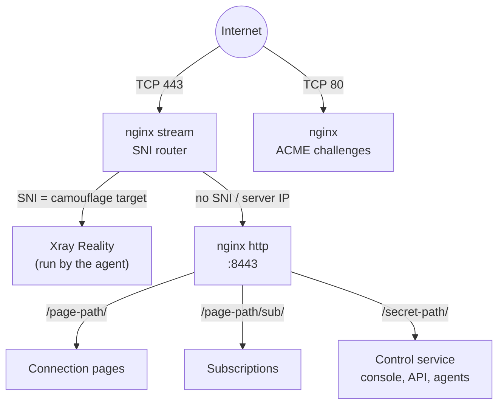
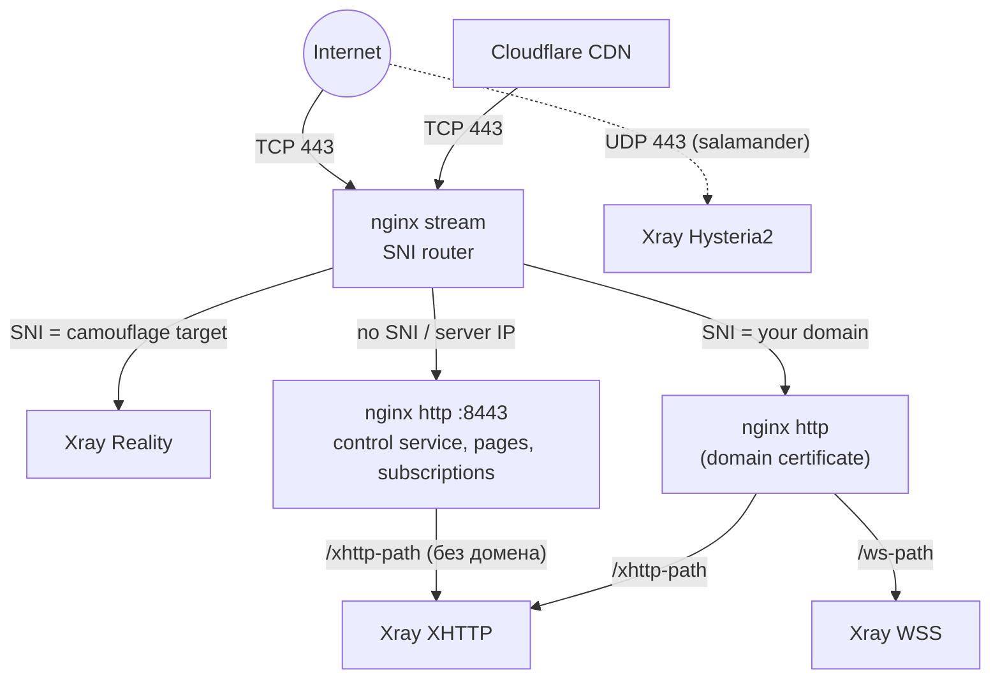
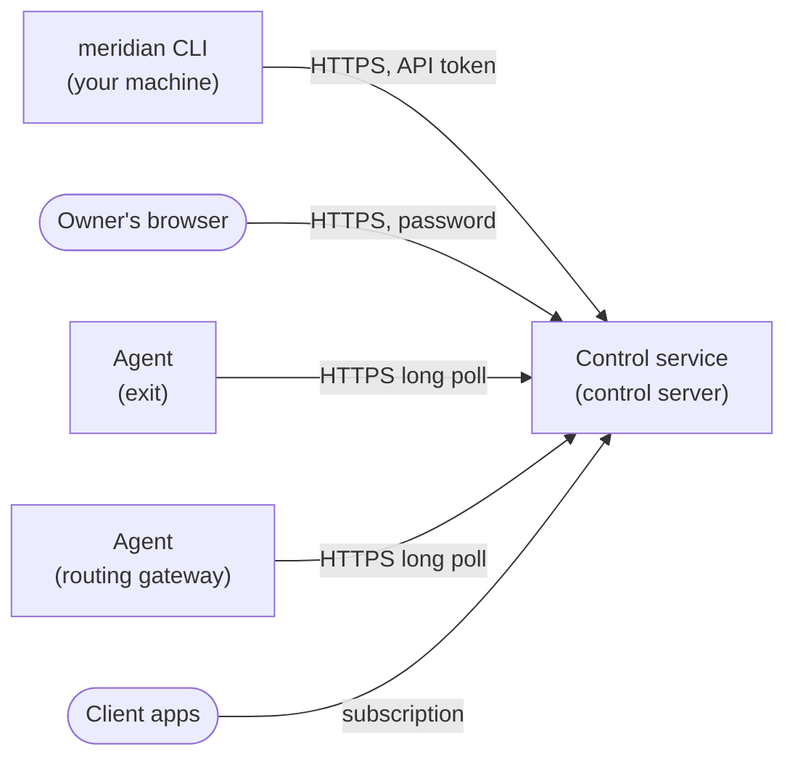

## Стек технологий

- **VLESS+Reality** (Xray-core) — основной протокол. Маскируется под реальный TLS-сайт: любой, кто проверяет сервер, видит подлинный сертификат этого сайта (лучше всего сайта, размещённого рядом с вашим сервером). Только клиенты с правильным ключом могут подключиться к вашему VPN.
- **XHTTP** (Xray-core) — путь TLS на вашем домене или, если домена нет, на IP сервера с IP-сертификатом Let's Encrypt.
- **WSS** (Xray-core) — путь TLS на собственном домене, добавляется в режиме домена. Если домен проксируется через Cloudflare, он и XHTTP проходят через CDN и переживают блокировку IP.
- **Hysteria2** (Xray-core) — последний резервный путь UDP/443 для ненадёжных сетей, обёрнутый в обфускацию salamander, чтобы не выглядеть как QUIC. Включён по умолчанию (`--no-hysteria2` отключает).
- **Сервис управления** — собственный сервис Meridian (`meridian serve`) на сервере управления. Он хранит пользователей, трафик, ревизии и резервные копии в одном файле SQLite, отдаёт подписки во всех форматах и обслуживает веб-консоль владельца. Работает как модуль systemd, без Docker и без сервера баз данных.
- **Агент узла** — небольшая статическая программа на Rust на каждом выходе и шлюзе маршрутизации. Он сам подключается к сервису управления по HTTPS на 443, проверяет подпись полученного документа и запускает Xray отдельным сервисом. Узлы не открывают порт управления.
- **nginx** — владеет публичным TCP/443. Его модуль stream маршрутизирует соединения по SNI без завершения TLS; его модуль http завершает TLS для сервиса управления, страниц подключения, подписок и путей домена. Сертификаты поступают от Let's Encrypt через [acme.sh](https://github.com/acmesh-official/acme.sh).
- **Realm** — TCP-форвардер на промежуточных серверах.
- **uTLS** — клиентские соединения копируют TLS Client Hello браузера (Chrome, а копии Firefox идут запасными записями), поэтому выглядят как обычный браузерный трафик.

## Топология сервисов

### Одиночный сервер (`meridian deploy IP`)

nginx stream **не** завершает TLS. Он читает SNI из Client Hello и пересылает необработанный TCP-поток. Сервис управления, страницы подключения и подписки обслуживаются сертификатом Let's Encrypt для IP сервера (короткоживущий, автоматически обновляется).

Общие ссылки находятся под путём страницы подключения: страницы в `/<page-path>/<id>/`, подписки в `/<page-path>/sub/<id>`. Консоль, API и точка подключения агентов находятся на отдельном секретном пути, который общие ссылки никогда не раскрывают.

### Режим домена

Домен несёт только пути прокси; сервис управления и страницы остаются на IP-сертификате.

### Промежуточные серверы

Промежуточный сервер пересылает необработанный TCP с внутреннего IP на слушатель Reality выхода. Шифрование сквозное, от клиента до выхода: промежуточный сервер никогда не видит трафик в открытом виде. Промежуточные серверы несут только Reality. `meridian setup` может также строить многозвенные цепочки промежуточных серверов и шлюзы маршрутизации, которые выбирают выход (или проверяемый пул выходов) по правилу либо выпускают подходящий трафик напрямую со шлюза.

### Сервис управления и агенты

Все соединения направлены к сервису управления; к узлам не подключается никто. Каждый агент сам подключается по HTTPS на 443, ждёт новый документ и сообщает, что применил и сколько трафика насчитал. Сервис управления подписывает каждый документ узла собственным ключом ваших серверов, а агент отвергает документ с неверной подписью, поэтому поддельный или повторно отправленный документ ничего не меняет. Новый узел подключается по одноразовому токену регистрации, который Meridian передаёт ему по SSH, а затем получает сертификат от собственного удостоверяющего центра ваших серверов.

Трафик учитывается один раз, даже если отчёт пришёл повторно. Сервис хранит итоги по каждому человеку и никогда не записывает, откуда кто подключается.

## Как работает Reality

1. Каждый выход имеет **пару ключей x25519**. Клиенты получают открытый ключ; приватный ключ остаётся на сервере.
2. Клиент подключается на порту 443 с TLS Client Hello, называющим цель маскировки (например, `www.google.com`).
3. Для наблюдателя это выглядит как обычное HTTPS соединение с этим сайтом.
4. **Зондировщик** без ключа пропускается к реальному сайту и видит его подлинный сертификат.
5. Клиент с действительной аутентификацией получает туннель VLESS.
6. **uTLS** делает Client Hello совпадающим с Chrome, преодолевая TLS fingerprinting.

## Модель состояния

- **Топология** — `~/.config/meridian/cluster.yml` на вашей машине содержит одобренную топологию (сервер управления, выходы, промежуточные серверы, шлюзы, пути протокола и список пользователей), адрес и API-токен сервиса управления и ключи, которые сгенерировал Meridian. `meridian setup`, `deploy`, `client add`, `node add` и `relay add` изменяют её; не редактируйте вручную.
- **Клиенты** — учётные записи, ключи, статус, лимиты и трафик живут в базе сервиса управления на сервере управления.
- **Ревизии** — сервис управления записывает каждое одобренное применение: кто его сделал, его план и применилось ли оно. `meridian fleet history` показывает их.
- **Снимки** — после каждого изменения каждая машина, которая управляет вашими серверами, сохраняет в `snapshots/` зашифрованную копию состояния сервиса управления; прочитать её можно ключом этой машины или ключом восстановления. См. [Восстановление](/ru/recovery/#сервер-управления-потерян).
- **Сохранённые серверы** — `~/.config/meridian/servers.json` содержит детали подключения SSH.

## План и применение

Meridian преобразует топологию в список ресурсов: правила файрвола, маршруты nginx, сертификаты, сервисы Realm, агенты узлов, документы, которые выполняет каждый узел, клиентские точки подключения и учётные записи пользователей. `meridian plan` проверяет каждый из них на живых серверах и в сервисе управления и сообщает, что нужно исправить. `meridian apply` применяет точно показанный план с контрольной точкой на каждом шаге, чтобы прерванное применение безопасно возобновилось. Ресурсы с неопределённым результатом проверяются заново перед любым повтором. На время применения сервис управления выдаёт аренду, поэтому две машины никогда не применяют одновременно, а машина с устаревшей копией отказывается применять, пока её не обновят.

В топологии можно добавлять и удалять что угодно: пользователей, пути протокола, выходы, промежуточные серверы и шлюзы маршрутизации. После того как новый план сходится, apply удаляет то, что его покинуло (пользователей, клиентские точки подключения, агентов узлов и их Xray, файлы nginx, сервисы Realm, сертификаты, правила файрвола). Исключение — сервер управления: его адрес входит в каждый URL подписки, поэтому он уходит только через `meridian teardown` или переезжает через `meridian restore`.

Статус, лимиты и срок действия клиентов принадлежат вам, в CLI или в консоли; применения их никогда не меняют.

## Назначения портов

| Порт | Сервис | Область |
|------|--------|--------|
| 443/TCP | nginx stream (SNI маршрутизатор) | Публичный |
| 443/UDP | Xray Hysteria2 (включён по умолчанию) | Публичный |
| 80/TCP | nginx (ACME задачи) | Публичный |
| 8443 | nginx http (сервис управления, страницы, подписки) | Внутренний |
| 8444 | nginx http, слушатель с протоколом PROXY | Внутренний |
| 3000 | Сервис управления (консоль, API, агенты, подписки) | localhost |
| 10000+ | Xray Reality (на выход) | сеть хоста, за файрволом |
| 20000+ | Xray WSS (режим домена, на выход) | сеть хоста, за файрволом |
| 30000+ | Xray XHTTP (на выход) | сеть хоста, за файрволом |

Backend-порты Xray достигаются через nginx; UFW блокирует их из интернета. Агенты только подключаются сами, поэтому ни один узел не открывает порт управления. Промежуточные серверы открывают только SSH и свой порт слушания.

## Сервисы

Имена модулей и каталогов нейтральны: хост, где смотрят `systemctl` или `/opt`, не увидит ничего, что называет прокси-ПО. `meridian check` и `meridian doctor` показывают роль, стоящую за каждым именем. Docker серверам не нужен.

**На сервере управления:**
- `ctld` — сервис управления, `meridian serve` из закреплённой установки в `/opt/ctld`, на `127.0.0.1:3000` за nginx

**На каждом выходе и шлюзе маршрутизации** (и на сервере управления, если он тоже выход):
- `netagent` — агент узла
- `netcore` — Xray, который запускает и настраивает агент

**На каждом промежуточном сервере:**
- `netfwd-*` — по одному сервису Realm на каждое звено

Агент — статическая программа для серверов x86-64 и ARM64. Когда новый выпуск приносит новую сборку, Meridian обновляет агента на месте и сохраняет идентичность узла.

## Демонтаж

`meridian teardown IP` удаляет сервис управления, агента и Xray, файлы nginx Meridian, сертификаты, сервисы Realm и правила файрвола (плюс 3x-ui из Meridian 3.x). Системные пакеты остаются. На одиночном серверном развёртывании удаляет также локальный `cluster.yml`. Если серверов несколько, отказывает тем, у которых всё ещё есть роль.

## Расположения файлов

### На сервере управления
- `/opt/ctld/` — закреплённая установка сервиса управления
- `/etc/ctld/config.json` — его конфигурация
- `/var/lib/ctld/` — его база данных (пользователи, трафик, ревизии, ключи резервных копий)
- `/etc/nginx/stream.d/meridian-v4-*.conf` — SNI маршрутизация
- `/etc/nginx/sites-available/meridian-v4-*.conf` — TLS сайты и обратный прокси
- `/etc/ssl/meridian/` — сертификаты

### На каждом выходе и шлюзе маршрутизации
- `/usr/local/bin/netagent` — агент
- `/etc/netagent/` — его регистрация и конфигурация Xray, которую он пишет
- `/var/lib/netagent/` — его ключи, сертификат и состояние
- `/usr/local/lib/netagent/` — Xray

### На каждом промежуточном сервере
- `/etc/netfwd/` — конфигурация Realm, запущена из `/usr/local/bin/netfwd` через сервисы `netfwd-*` systemd. На промежуточных серверах нет модулей с названиями Meridian, путей или комментариев файрвола (`fw-*`).

### На вашей машине
- `~/.config/meridian/cluster.yml` — топология, доступ к сервису управления, ключи
- `~/.config/meridian/cluster.yml.bak` — резервная копия, сделанная перед деструктивными операциями
- `~/.config/meridian/servers.json` — сохранённые SSH серверы
- `~/.config/meridian/setup.json` — ход `meridian setup` (без секретов)
- `~/.config/meridian/snapshots/` — зашифрованные снимки сервиса управления
- `~/.config/meridian/device.key` — ключ этой машины для этих снимков
- `~/.config/meridian/ssh/meridian_ed25519` — управляемый SSH ключ, когда сгенерирован
- `~/.config/meridian/cache/` — кэш проверки обновлений

Каталог следует `$XDG_CONFIG_HOME`, если эта переменная задана, а `MERIDIAN_HOME` переопределяет его. Пока `~/.config/meridian/` не существует, Meridian также использует `~/.meridian-v4/` или `~/.meridian/`, если в одном из них лежат ваши серверы (в нём есть `servers.json`). Состояние Meridian 3.x в `~/.meridian/` никогда не затрагивается.

На одном компьютере можно держать несколько наборов серверов как контексты (`meridian context`). Этот каталог — контекст `default`; другой контекст хранит свои `cluster.yml`, его резервную копию, `servers.json`, `setup.json`, снимки и ключ машины в `contexts/NAME/`, а SSH-ключ, кэш проверки обновлений, выбор языка и локальный Xray остаются общими. Контекст выбирают `--context`, затем `MERIDIAN_CONTEXT`, затем сохранённый `current-context`; `MERIDIAN_HOME` закрепляет один набор.
