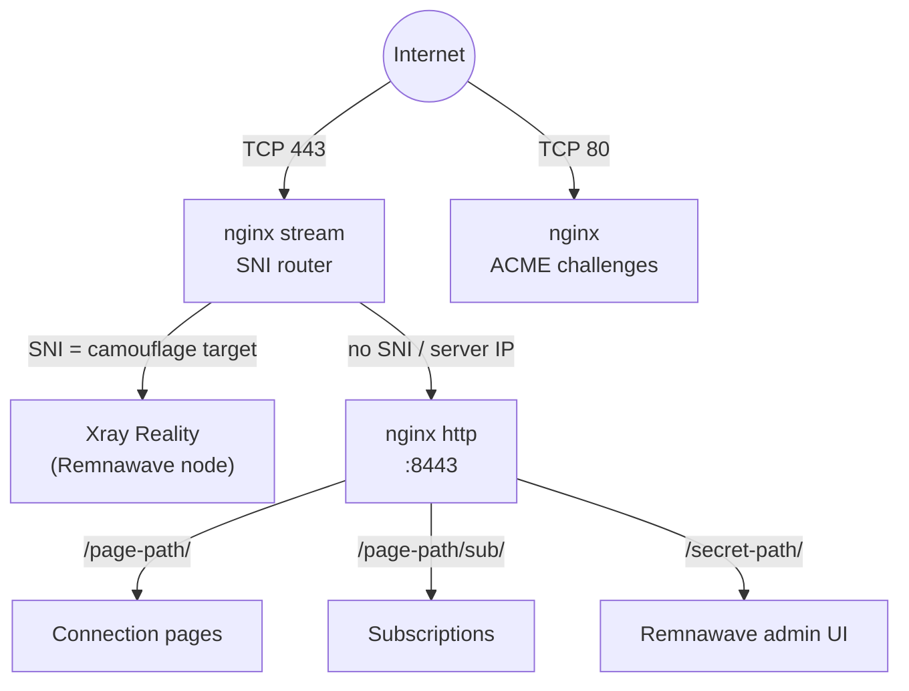
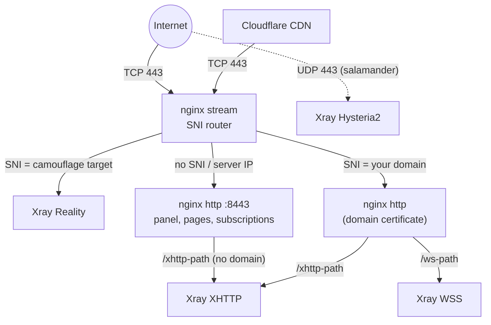
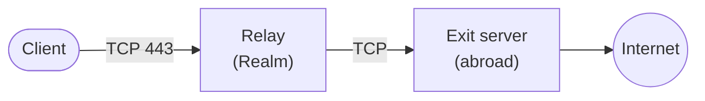

## 技术栈

- **VLESS+Reality**（Xray-core）— 主要协议。它伪装成真实的 TLS 网站：任何探测服务器的人都会看到该网站的真实证书（最好是与你的服务器托管在同一网络的网站）。只有拥有正确密钥的客户端才能到达代理。
- **XHTTP**（Xray-core）— 你域名上的 TLS 路径；没有域名时，则使用服务器 IP 和 Let's Encrypt IP 证书。
- **WSS**（Xray-core）— 域名模式下添加的、你自己域名上的 TLS 路径。通过 Cloudflare 代理域名后，它和 XHTTP 都经过 CDN，即使 IP 被阻止也仍然可用。
- **Hysteria2**（Xray-core）— 用于丢包网络的 UDP/443 最后手段，用 salamander 混淆包装，看起来不像 QUIC。默认开启（`--no-hysteria2` 可关闭）。
- **Remnawave** — 面板堆栈：`remnawave/backend`（API 和管理 UI，带 PostgreSQL 和 Valkey）在控制平面服务器上，`remnawave/node`（运行 Xray）在每个出口上，以及 `remnawave/subscription-page`。Meridian 固定测试版本并通过 REST API 与面板通信。
- **nginx** — 拥有公开 TCP/443。其 stream 模块按 SNI 路由连接而不终止 TLS；其 http 模块为面板、连接页面、订阅和域名路径终止 TLS。证书来自通过 [acme.sh](https://github.com/acmesh-official/acme.sh) 的 Let's Encrypt。
- **Realm** — 中继服务器上的 TCP 转发器。
- **uTLS** — 客户端连接复制浏览器的 TLS Client Hello（以 Chrome 为主，另有 Firefox 副本作为备用条目），所以看起来像普通浏览器流量。

## 服务拓扑

### 单服务器（`meridian deploy IP`）

nginx stream **不**终止 TLS。它从 Client Hello 中读取 SNI 并转发原始 TCP 流。面板、连接页面和订阅使用服务器 IP 的 Let's Encrypt 证书提供（短期有效，自动续期）。

共享链接位于连接页面路径下：页面在 `/<page-path>/<id>/`，订阅在 `/<page-path>/sub/<id>`。管理面板位于共享链接永远不会暴露的单独密钥路径上。

### 域名模式

域名只承载代理路径；面板和页面留在 IP 证书上。

### 中继

中继从国内 IP 转发原始 TCP 到出口的 Reality 监听器。端到端加密在客户端和出口之间；中继永远看不到明文。中继仅承载 Reality。`meridian setup` 还可以构建多跳中继链和路由网关，按规则选择出口（或健康检查的出口池）。

## Reality 协议如何工作

1. 每个出口有一个 **x25519 密钥对**。客户端获得公钥；私钥留在服务器上。
2. 客户端在端口 443 上连接，发送命名伪装目标（例如 `www.google.com`）的 TLS Client Hello。
3. 对观察者来说，这是对该网站的普通 HTTPS 连接。
4. 没有密钥的**探针**被传递到真实网站并看到其有效证书。
5. 拥有有效认证的客户端获得 VLESS 隧道。
6. **uTLS** 使 Client Hello 与 Chrome 的相匹配，击败 TLS 指纹识别。

## 状态模型

- **拓扑** — `~/.config/meridian/cluster.yml` 在您的机器上保存已审核的拓扑（控制平面、出口、中继、网关、协议路径和用户列表）、面板访问和 Meridian 生成的密钥。`meridian setup`、`deploy`、`client add`、`node add` 和 `relay add` 改变它；不要手工编辑它。
- **客户端** — 账户、密钥、状态和流量位于控制平面服务器上的 Remnawave 数据库中。
- **保存的服务器** — `~/.config/meridian/servers.json` 保存 SSH 连接详情。

## 计划和应用

Meridian 将拓扑转换为资源列表：防火墙规则、nginx 路由、容器、Remnawave 配置文件、主机、用户和模板。`meridian plan` 在实时服务器和面板上观察每一个并报告需要修复的内容。`meridian apply` 应用它显示的确切计划，在每一步设置检查点，以便中断的应用可以安全地恢复。结果不确定的资源在任何重试之前会被重新观察。

用户和协议路径可以添加和删除；在新计划收敛后，应用删除离开它的东西（面板用户和主机、nginx 文件、防火墙规则）。从运行中的集群删除出口、中继或路由网关目前被拒绝。

对面板拥有资源的编辑会在 `meridian plan` 中显示，并由下一次应用恢复。Meridian 不管理的 Remnawave 设置被保留。

## 端口分配

| 端口 | 服务 | 范围 |
|------|---------|-------|
| 443/TCP | nginx stream（SNI 路由器） | 公开 |
| 443/UDP | Xray Hysteria2（默认开启） | 公开 |
| 80/TCP | nginx（ACME 挑战） | 公开 |
| 8443 | nginx http（面板、页面、订阅） | 内部 |
| 8444 | nginx http，PROXY 协议监听器（与 `--client-ips` 配合使用） | 内部 |
| 3000 | Remnawave 后端（管理 UI + API） | localhost |
| 3010 | Remnawave 节点 API | host network |
| 3020 | Remnawave 订阅页面 | localhost |
| 10000+ | Xray Reality（每个出口） | host network，被防火墙阻止 |
| 20000+ | Xray WSS（域名模式，每个出口） | host network，被防火墙阻止 |
| 30000+ | Xray XHTTP（域名模式，每个出口） | host network，被防火墙阻止 |

后端 Xray 端口通过 nginx 到达；UFW 从互联网阻止它们。中继服务器仅打开 SSH 和其监听端口。

## Docker 容器

**在控制平面服务器上：**
- `remnawave` — 后端 API 和管理 UI 在 `127.0.0.1:3000`
- `remnawave-db` — PostgreSQL（用户、主机、配置文件）
- `remnawave-redis` — Valkey 缓存
- `remnawave-subscription-page` — 订阅前端在 `127.0.0.1:3020`
- `remnawave-node` — Xray，在 host network 中，带 `NET_ADMIN`

**在其他每个出口上：**
- 仅 `remnawave-node`，通过每个节点的密钥在面板注册

## 卸载

`meridian teardown IP` 移除面板和节点容器及卷、Meridian 的 nginx 文件、证书、Realm 服务和防火墙规则（加上 Meridian 3.x 的 3x-ui）。Docker 和系统包保留。在单服务器部署中它也移除本地 `cluster.yml`。在多服务器集群中它拒绝仍有角色的服务器。

## 文件位置

### 在控制平面服务器上
- `/opt/remnawave/` — 面板 compose 文件和 `.env`
- `/etc/nginx/stream.d/meridian-v4-*.conf` — SNI 路由
- `/etc/nginx/sites-available/meridian-v4-*.conf` — TLS 网站和反向代理
- `/etc/ssl/meridian/` — 证书

### 在每个出口上
- `/opt/remnanode/` — 节点 compose 文件和 `.env`

### 在每个中继上
- `/etc/netfwd/` — Realm 配置，从 `/usr/local/bin/netfwd` 由 `netfwd-*` systemd 服务运行。中继主机不带任何 Meridian 命名的单位、路径或防火墙注释（`fw-*`）；下一个 `meridian apply` 重命名在较旧的 `meridian-realm-*` 名字下部署的跳跃

### 在您的机器上
- `~/.config/meridian/cluster.yml` — 拓扑、面板访问、密钥
- `~/.config/meridian/cluster.yml.bak` — 破坏性操作前的备份
- `~/.config/meridian/servers.json` — 保存的 SSH 服务器
- `~/.config/meridian/setup.json` — `meridian setup` 进度（无秘密）
- `~/.config/meridian/ssh/meridian_ed25519` — 托管 SSH 密钥，生成时
- `~/.config/meridian/cache/` — 更新检查缓存

该目录在设置了 `$XDG_CONFIG_HOME` 时跟随它，`MERIDIAN_HOME` 则会覆盖它。已存放在 `~/.meridian-v4/` 或 `~/.meridian/` 中的 4.0 集群（通过 `servers.json` 识别）会继续从原处使用，直到 `~/.config/meridian/` 出现；`~/.meridian/` 中的 3.x 状态不会被触碰。
