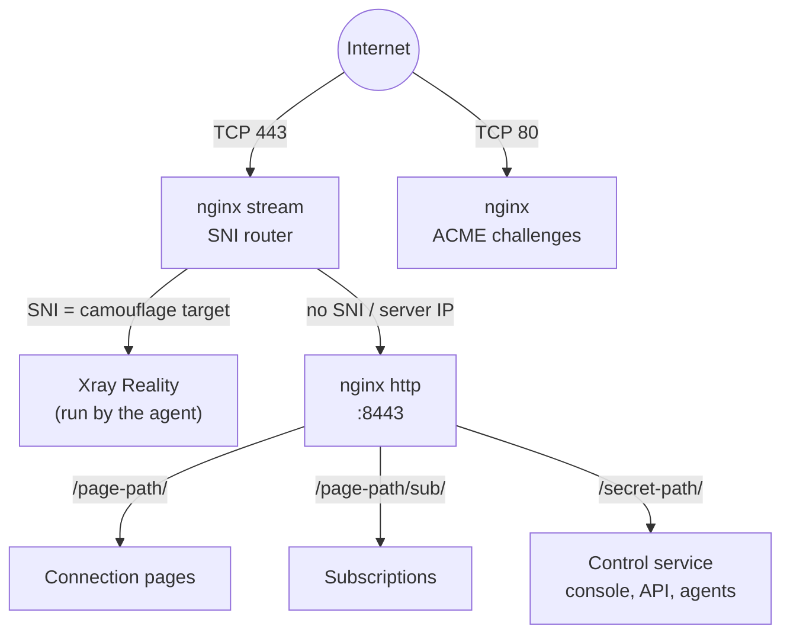
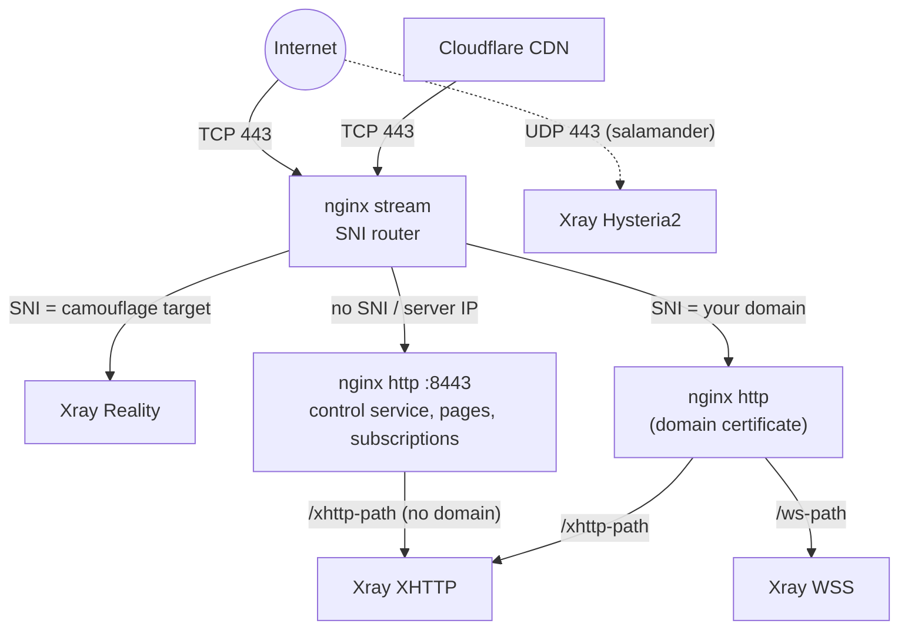
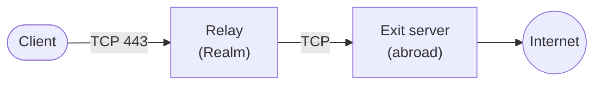
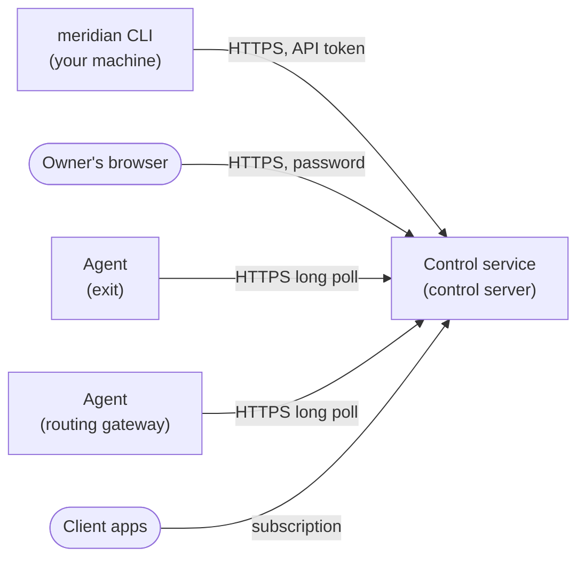

## 技术栈

- **VLESS+Reality**（Xray-core）— 主要协议。它伪装成真实的 TLS 网站：任何探测服务器的人都会看到该网站的真实证书（最好是与你的服务器托管在同一网络的网站）。只有拥有正确密钥的客户端才能到达代理。
- **XHTTP**（Xray-core）— 你域名上的 TLS 路径；没有域名时，则使用服务器 IP 和 Let's Encrypt IP 证书。
- **WSS**（Xray-core）— 域名模式下添加的、你自己域名上的 TLS 路径。通过 Cloudflare 代理域名后，它和 XHTTP 都经过 CDN，即使 IP 被封锁也仍然可用。
- **Hysteria2**（Xray-core）— 用于丢包网络的 UDP/443 最后手段，用 salamander 混淆包装，看起来不像 QUIC。默认开启（`--no-hysteria2` 可关闭）。
- **控制服务** — Meridian 自己的服务（`meridian serve`），运行在控制服务器上。它把用户、流量、修订和备份保存在一个 SQLite 文件中，提供所有格式的订阅，并承载所有者的网页控制台。它以 systemd 单元运行，不需要 Docker，也不需要数据库服务器。
- **节点 agent** — 每个出口和路由网关上的一个小型静态 Rust 程序。它主动通过 443 端口的 HTTPS 连接控制服务，校验收到的签名文档，并以独立服务运行 Xray。节点不开放任何管理端口。
- **nginx** — 拥有公开 TCP/443。其 stream 模块按 SNI 路由连接而不终止 TLS；其 http 模块为控制服务、连接页面、订阅和域名路径终止 TLS。证书来自通过 [acme.sh](https://github.com/acmesh-official/acme.sh) 的 Let's Encrypt。
- **Realm** — 中继服务器上的 TCP 转发器。
- **uTLS** — 客户端连接复制浏览器的 TLS Client Hello（以 Chrome 为主，另有 Firefox 副本作为备用条目），所以看起来像普通浏览器流量。

## 服务拓扑

### 单服务器（`meridian deploy IP`）

图中的公开方框表示由 `ctld` 处理的 URL 路由：页面路径根目录重定向旧 UUID 链接，`/sub/` 提供浏览器页面、应用配置和共享资源。

nginx stream **不**终止 TLS。它从 Client Hello 中读取 SNI 并转发原始 TCP 流。控制服务、连接页面和订阅使用服务器 IP 的 Let's Encrypt 证书提供（短期有效，自动续期）。

共享链接只有一个地址：`/<page-path>/sub/<token>`。浏览器获得连接页面，应用获得适合自己的配置。控制台、API 和 agent 接入点位于共享链接永远不会暴露的独立秘密路径上。

控制服务根据当前用户、连接端点、品牌设置和出口国家生成页面、`config.json` 和清单。每个人都有页面，包括在控制台中添加的用户。个人响应使用 `Cache-Control: no-store` 并禁止索引；安装包中的共享资源位于 `/<page-path>/sub/~pwa/` 下，以内容版本标识。nginx 提供 Referrer-Policy 和压缩，控制服务提供页面的 CSP 及其他浏览器保护头。旧的 `/<page-path>/<uuid>/` 链接会重定向到当前订阅 URL。应用升级会删除旧页面文件，并让旧 service worker 释放缓存的页面。

### 域名模式

域名只承载代理路径；控制服务和页面留在 IP 证书上。

### 中继

中继从国内 IP 转发原始 TCP 到出口的 Reality 监听器。端到端加密在客户端和出口之间；中继永远看不到明文。中继仅承载 Reality。`meridian setup` 还可以构建多跳中继链和路由网关，按规则选择出口（或健康检查的出口池），或让匹配的流量直接从网关发出。

### 控制服务与 agent

所有连接都指向控制服务；没有任何东西会连接到节点。每个 agent 主动通过 443 端口的 HTTPS 连出，等待新文档，并报告它应用了什么以及统计到的流量。控制服务用你的集群自己的密钥为每份节点文档签名，agent 会拒绝签名无法验证的文档，因此伪造或重放的文档不会产生任何改变。新节点使用 Meridian 通过 SSH 交给它的一次性注册令牌加入，之后持有由集群自己的证书颁发机构签发的证书。

即使报告重发，流量也只统计一次。默认保留累计总量和最后活跃时间，不保存客户端 IP 地址。可选[隐私](/zh/privacy/)设置增加有保留上限的人员及服务器每日总量、设备指纹或完整设备详情。

## Reality 协议如何工作

1. 每个出口有一个 **x25519 密钥对**。客户端获得公钥；私钥留在服务器上。
2. 客户端在端口 443 上连接，发送命名伪装目标（例如 `www.google.com`）的 TLS Client Hello。
3. 对观察者来说，这是对该网站的普通 HTTPS 连接。
4. 没有密钥的**探针**被传递到真实网站并看到其有效证书。
5. 拥有有效认证的客户端获得 VLESS 隧道。
6. **uTLS** 使 Client Hello 与 Chrome 的相匹配，击败 TLS 指纹识别。

## 状态模型

- **拓扑** — `~/.config/meridian/cluster.yml` 在你的机器上保存已审核的拓扑（控制服务器、出口、中继、网关、协议路径和用户列表）、控制服务的地址和 API 令牌，以及 Meridian 生成的密钥。`meridian setup`、`deploy`、`client add`、`node add` 和 `relay add` 会修改它；请勿手动编辑。
- **客户端** — 账户、密钥、状态、限额和流量位于控制服务器上控制服务的数据库中。
- **修订** — 控制服务记录每一次经过审核的应用：谁发起的、它的计划，以及是否应用成功。`meridian fleet history` 会列出它们。
- **快照** — 每次变更后，每台管理集群的机器都会在 `snapshots/` 中保存一份控制服务状态的加密副本，可用该机器的密钥或恢复密钥读取。参见[恢复](/zh/recovery/#控制服务器丢失)。
- **已保存的服务器** — `~/.config/meridian/servers.json` 保存 SSH 连接详情。

## 计划与应用

Meridian 会将拓扑编译为资源列表：防火墙规则、nginx 路由、证书、Realm 服务、节点 agent、每个节点运行的文档、客户端接入点和用户。`meridian plan` 在运行中的服务器和控制服务上检查每项资源，并报告需要修复的内容。`meridian apply` 会原样应用其展示的计划，在每一步保存检查点，以便中断后安全恢复。结果不确定的资源在重试前会先重新检查状态。应用期间会在控制服务中持有一个租约，因此两台机器永远不会同时应用；副本落后的机器会拒绝应用，直到它更新为止。

拓扑中的任何内容都可以添加和移除：用户、协议路径、出口、中继和路由网关。在新计划收敛后，`apply` 会清理已移出拓扑的资源（用户、客户端接入点、节点 agent 及其 Xray、nginx 配置文件、Realm 服务、证书、防火墙规则）。控制服务器是例外：它的地址包含在每个订阅 URL 中，因此只能通过 `meridian teardown` 卸载，或通过 `meridian restore` 迁移。

客户端的状态、限额和到期时间归你管理，可以在 CLI 或控制台中修改；应用永远不会改动它们。

## 端口分配

| 端口 | 服务 | 范围 |
|------|------|------|
| 443/TCP | nginx stream（SNI 路由器） | 公开 |
| 443/UDP | Xray Hysteria2（默认开启） | 公开 |
| 80/TCP | nginx（ACME 验证） | 公开 |
| 8443 | nginx http（控制服务、连接页面、订阅） | 内部 |
| 8444 | nginx http，PROXY 协议监听端口 | 内部 |
| 3000 | 控制服务（控制台、API、agent、订阅） | localhost |
| 10000+ | Xray Reality（每个出口） | host network，由防火墙拦截外部访问 |
| 20000+ | Xray WSS（域名模式，每个出口） | host network，由防火墙拦截外部访问 |
| 30000+ | Xray XHTTP（每个出口） | host network，由防火墙拦截外部访问 |

后端 Xray 端口仅通过 nginx 访问；UFW 防火墙会拦截来自互联网的直接连接。agent 只主动连出，因此没有节点开放管理端口。中继服务器仅开放 SSH 和其监听端口。

## 服务

单元和目录名称都是中性的，因此在主机上查看 `systemctl` 或 `/opt` 时看不到任何指向代理软件的名称。`meridian check` 和 `meridian doctor` 会显示每个名称背后的角色。服务器不需要 Docker。

**在控制服务器上：**
- `ctld` — 控制服务，即从 `/opt/ctld` 中固定版本的安装运行的 `meridian serve`，监听 `127.0.0.1:3000`，位于 nginx 之后

**在每个出口和路由网关上**（控制服务器同时是出口时也包括它）：
- `netagent` — 节点 agent
- `netcore` — 由 agent 启动和配置的 Xray

**在每个中继上：**
- `netfwd-*` — 每个中继跳一个 Realm 服务

agent 是适用于 x86-64 和 ARM64 服务器的静态程序。新版本带来新构建时，Meridian 会就地升级它，并保留节点的身份。

## 卸载

`meridian teardown IP` 移除控制服务、agent 和 Xray、Meridian 的 nginx 文件、证书、Realm 服务和防火墙规则（加上 Meridian 3.x 的 3x-ui）。系统包保留。在单服务器部署中它也移除本地 `cluster.yml`。在多服务器集群中它拒绝仍有角色的服务器。

## 文件位置

### 在控制服务器上
- `/opt/ctld/` — 控制服务的固定版本安装
- `/etc/ctld/config.json` — 它的配置
- `/var/lib/ctld/` — 它的数据库（用户、流量、修订、备份密钥）
- `/etc/nginx/stream.d/meridian-v4-*.conf` — SNI 路由
- `/etc/nginx/sites-available/meridian-v4-*.conf` — TLS 网站和反向代理
- `/etc/ssl/meridian/` — 证书

### 在每个出口和路由网关上
- `/usr/local/bin/netagent` — agent
- `/etc/netagent/` — 它的注册信息和它写入的 Xray 配置
- `/var/lib/netagent/` — 它的密钥、证书和状态
- `/usr/local/lib/netagent/` — Xray

### 在每个中继上
- `/etc/netfwd/` — Realm 配置，从 `/usr/local/bin/netfwd` 由 `netfwd-*` systemd 服务运行。中继主机不带任何 Meridian 命名的单位、路径或防火墙注释（`fw-*`）。

### 在你的机器上
- `~/.config/meridian/cluster.yml` — 拓扑、控制服务访问、密钥
- `~/.config/meridian/cluster.yml.bak` — 破坏性操作前的备份
- `~/.config/meridian/servers.json` — 保存的 SSH 服务器
- `~/.config/meridian/setup.json` — `meridian setup` 进度（无秘密）
- `~/.config/meridian/snapshots/` — 控制服务的加密快照
- `~/.config/meridian/device.key` — 这台机器用于读取这些快照的密钥
- `~/.config/meridian/ssh/meridian_ed25519` — 托管 SSH 密钥，生成时
- `~/.config/meridian/cache/` — 更新检查缓存

该目录在设置了 `$XDG_CONFIG_HOME` 时跟随它，`MERIDIAN_HOME` 则会覆盖它。在 `~/.config/meridian/` 不存在期间，若 `~/.meridian-v4/` 或 `~/.meridian/` 中存有集群（含有 `servers.json`），Meridian 也会使用它们。`~/.meridian/` 中的 Meridian 3.x 状态不会被触碰。

一台电脑可以用上下文（`meridian context`）保存多组服务器。该目录就是 `default` 上下文；其他上下文在 `contexts/NAME/` 中保存自己的 `cluster.yml`、其备份、`servers.json`、`setup.json`、快照和设备密钥，而 SSH 密钥、更新检查缓存、语言选择和本地 Xray 运行时是共用的。选择顺序为 `--context`、`MERIDIAN_CONTEXT`、已保存的 `current-context`；`MERIDIAN_HOME` 固定使用单独一组。
